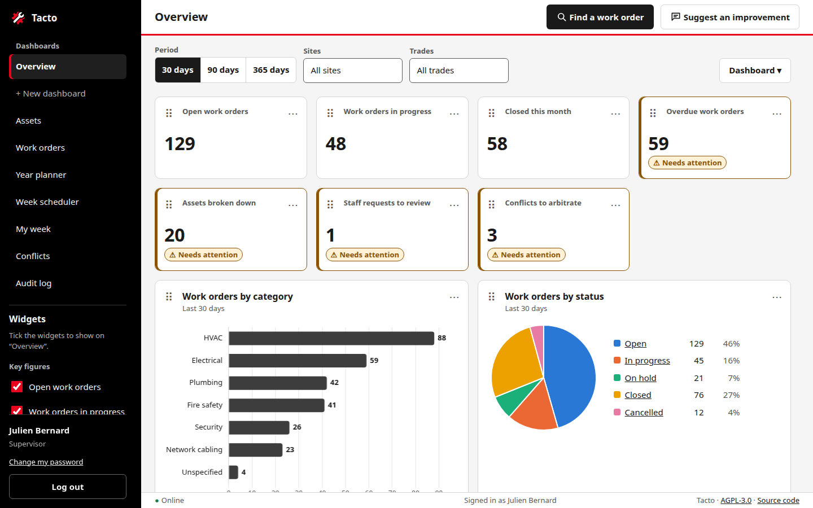
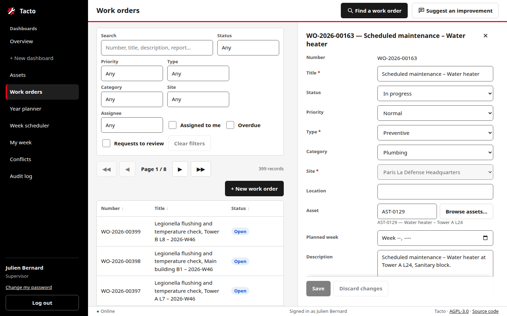
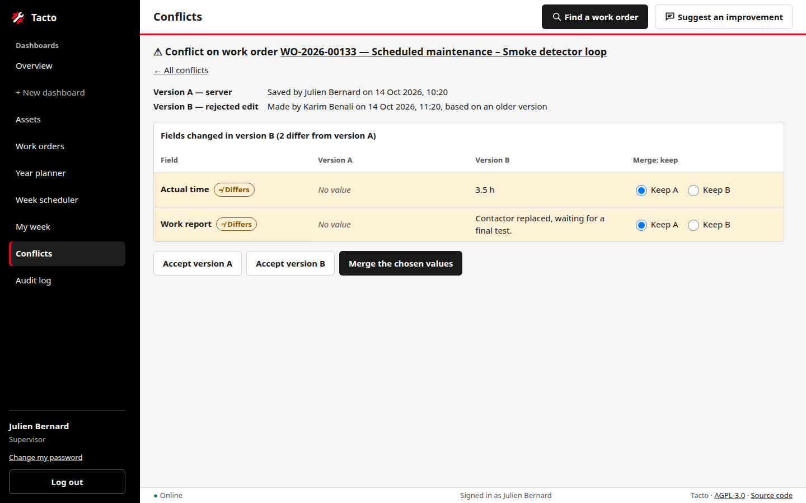
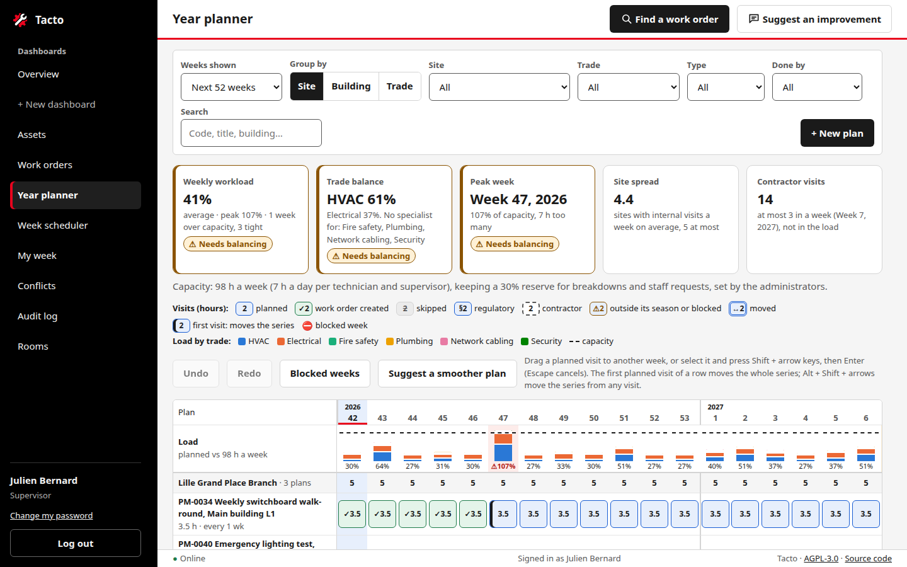
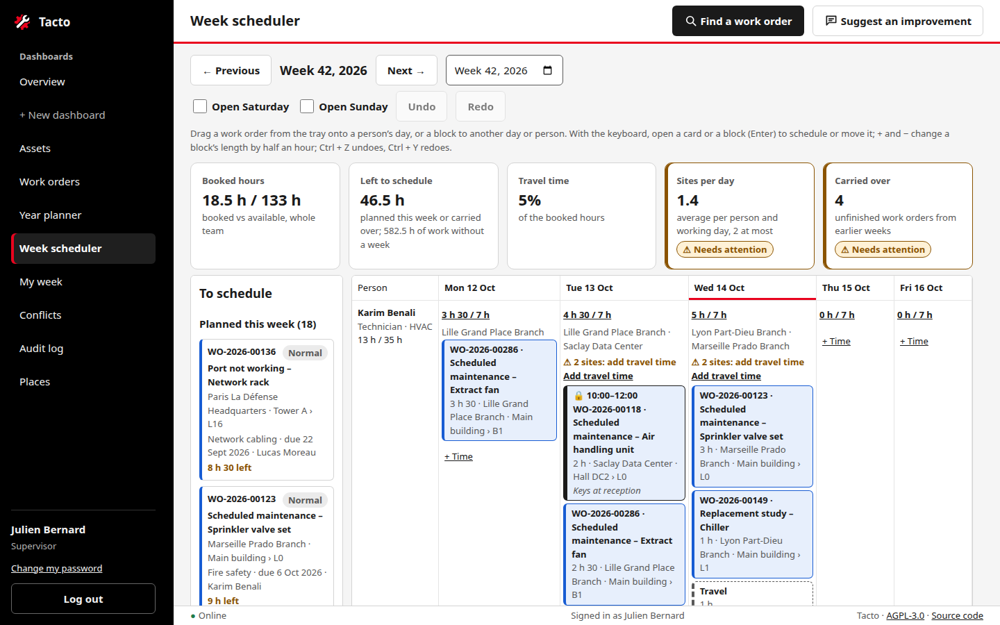
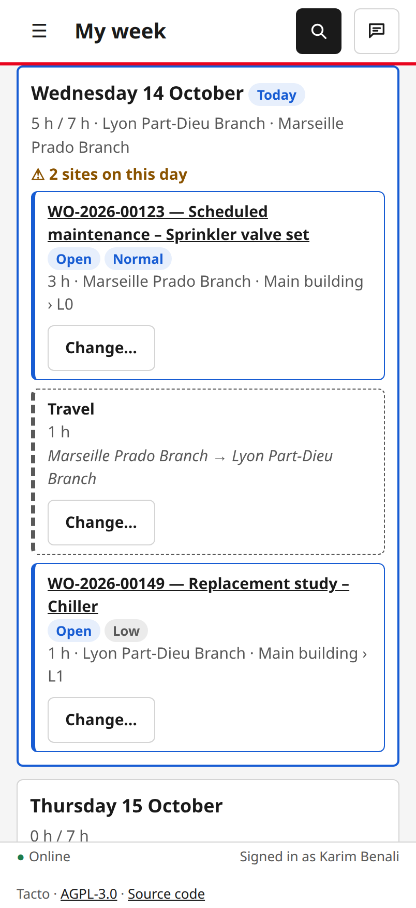
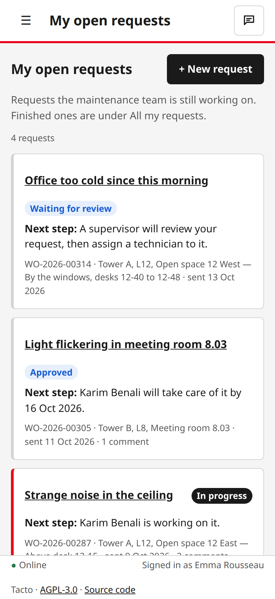
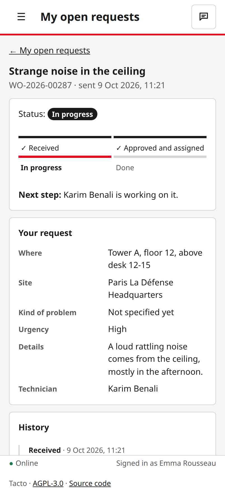

# Tacto

Computerized Maintenance Management System (CMMS). It focuses on user experience: very fast browsing of assets and work orders from a local IndexedDB cache, offline use, conflict detection with supervisor arbitration, and a KPI dashboard.

It started as an MVP (phases 0–7, brief in `docs/SPEC_MVP_CMMS.md`), the first building block of a broader product vision: AI copilot, adaptive interface, IoT, digital twin. The MVP is complete and the project is now maintained as a production application (D73).

> **Status:** phases 0–24 and 26–28 are built (see `docs/roadmap.md`): the MVP (phases 0–7: assets and work orders, local-first browsing and offline use, editing with conflicts and supervisor arbitration, the dashboard, hardening and deployment files), then asset creation, history and audit log, search and filters, user administration, staff requests, preventive maintenance (year planner, week scheduler, My week, balancing assistant), custom dashboards, the search part of the AI assistant, continuous integration, and releases with a backup before each update's migrations (`CHANGELOG.md`). Deployment files and guide are ready; the HTTPS deployment waits for a VPS. The features are listed below.

## Tech stack

| Layer | Choice |
|---|---|
| Backend | Node.js 24 LTS, Express 5 |
| Database | SQLite (`better-sqlite3`, WAL mode), plain SQL migrations |
| Frontend | HTML5, CSS3 (Grid), vanilla JavaScript (ES modules), no build step |
| Client storage | IndexedDB (`idb`), service worker for the app shell |
| Charts | Chart.js |
| Auth | Login + password (argon2), JWT (`jsonwebtoken`) |
| Validation | zod (API) |
| Tests | Vitest, Supertest, jsdom, fake-indexeddb |
| Hosting | Linux VPS, Nginx reverse proxy, systemd, Let's Encrypt |

## Features

- **Assets and work orders**: paginated tables (50 rows), table + detail split view, search, editing with per-role permissions and work order status workflow.
- **Work order creation**: from the work order list or directly from an asset, including offline (synced later without duplicates).
- **Asset creation and deletion** (supervisors and admins, online): automatic or typed codes; only assets without work orders can be deleted.
- **Search and filters**: full-text search (accents ignored, word prefixes) and filters above every table, kept in the URL; dashboard tiles open the matching list.
- **History and audit log**: every change is recorded with its author (field by field); each record shows its history, work orders their status timeline; supervisors and admins browse the global audit log.
- **Local-first**: IndexedDB cache with prefetch of adjacent pages, silent revalidation, offline browsing and editing, sync queue.
- **Save modes**: standard (explicit save, drafts every 60 s) and power user (auto-save when leaving a record).
- **Conflicts**: optimistic versioning, accessible conflict indicators, supervisor console with side-by-side arbitration (A / B / merge).
- **Dashboard**: KPI tiles, work orders by category over 30 days, recent activity, "my work today". Supervisors and admins build their own named dashboards (D59): widgets ticked in the sidebar, arranged by drag and drop or the keyboard, filtered by period, sites and trades, each exported as CSV (figures or the records behind them) or as a JPG image; flow and backlog widgets show opened vs closed work, the backlog by age and priority and in weeks of work, and planned vs reactive work; compliance widgets show preventive and regulatory visits done on time, the week schedule kept and a contractor scorecard; responsiveness, asset and people widgets show response times by priority, staff request service, the assets with the most breakdowns, repeat failures, critical assets out of service, workload per person and estimate accuracy; every bar or cell opens the work orders it counts.
- **Staff requests**: bank staff (role `STAFF`) submit requests ("I don't know" is accepted for the kind of problem and the urgency; the location is typed), follow their open requests with a plain-words status and next step, see all past requests, and exchange comments with the maintenance team, who handle each request as a work order. A supervisor or admin reviews each request first (dashboard tile "Staff requests to review"): approve it and assign a technician or supervisor, or reject it with a reason the requester sees.
- **English or French**: each user picks the language of the interface with the flags of the top bar (or of the login page); the browser remembers it (D85). Content stays as people typed it.
- **Roles**: `STAFF`, `TECHNICIAN`, `SUPERVISOR`, `ADMIN`.

Out of scope: deleting work orders (they are cancelled), inventory, attachments (see the backlog in `docs/roadmap.md`). The AI assistant (D66) only finds work orders by search until a model provider is chosen. Preventive maintenance (a 52-week year planner and a weekly scheduler per technician) is specified in `docs/spec-preventive-maintenance.md`: Phases 17–20 are built.

## Screenshots

Taken with the mock data (`npm run db:reset -- --with-conflicts`); `npm run docs:screenshots` takes them again (`docs/ui-guidelines.md` → Screenshots). **[The showcase](docs/showcase.md)** goes through every feature, role by role, in 45 pictures.

**Dashboard** (supervisor): KPI tiles that open the matching list, charts, widgets ticked in the sidebar.



**Work orders**: filters, paginated table and the detail panel side by side.



**Conflict arbitration**: two people edited the same work order; the supervisor keeps version A, version B or a field-by-field merge.



**Year planner**: preventive visits over 52 weeks, the load per week against capacity and the balance figures.



**Week scheduler**: work orders to schedule on the left, dragged onto each person's day.



**On a phone**: a technician's week, then a staff member's open requests and one request's progress.

<table>
  <tr>
    <td></td>
    <td></td>
    <td></td>
  </tr>
</table>

## Run locally

Prerequisites: Node.js 24 LTS and npm.

```bash
cp .env.example .env                 # then set JWT_SECRET and SEED_PASSWORD
cd backend
npm install
npm run db:reset                     # (re)create the database, migrate and seed mock data
npm run dev                          # API + frontend on http://localhost:3000, restarts on changes
```

Mock users (password = `SEED_PASSWORD`): `admin`, `supervisor1`, `supervisor2`, `technician1`, `technician2`, and the staff member `user1`, who only sees the request screens. Administrators manage accounts under **Users** (`/admin/users`); everyone can change their password with **Change my password** under their name in the sidebar. The **Suggest an improvement** button in the top bar saves ideas about the page on screen; administrators read them under **Suggestions**.

| URL | |
|---|---|
| http://localhost:3000 | application |
| http://localhost:3000/api/health | API health check |

### Useful commands

```bash
cd backend  && npm test              # backend tests (unit, database, API)
cd backend  && npm run lint          # ESLint + Prettier check (npm run format to fix)
cd backend  && npm run db:migrate    # apply new migrations (also done at server start)
cd backend  && npm run db:reset -- --with-conflicts   # reseed with 3 demo conflicts
cd backend  && npm run db:backup                       # backup into BACKUP_DIR (keeps 14 days)
cd backend  && npm run pm:release                      # create the work orders of plan visits due (daily job)
cd backend  && npm run feedback:export > ideas.md      # open suggestions (D40) as Markdown
cd backend  && CHECK_URL=https://staging.example.com npm run check:permissions   # every role × endpoint (docs/test-protocol.md, section 3)
cd backend  && npm run user:create-admin -- --username <name> --first-name <name> --last-name <name>   # first admin of an empty database (D70)
cd backend  && npm run docs:screenshots             # README and showcase pictures in docs/img/, from a throwaway mock database (Chromium needed)
cd frontend && npm install && npm test               # frontend logic tests (some compare with the backend rules: npm install in backend/ first)
```

Continuous integration (`.github/workflows/ci.yml`) runs `npm ci`, `npm run lint` and `npm test` in `backend/` and in `frontend/` on Node 24 for every push and pull request; a failing check marks the commit as failed on GitHub.

### Environment variables (`.env.example`)

| Variable | Purpose |
|---|---|
| `NODE_ENV` | `development` or `production` |
| `PORT` | API port (default 3000) |
| `DATABASE_PATH` | SQLite file path, relative to the repository root (default `./data/cmms.sqlite`) |
| `JWT_SECRET`, `JWT_EXPIRES_IN` | token signing secret and lifetime |
| `APP_TIMEZONE` | **your** time zone (IANA name, default `Europe/Paris`): "today", overdue work, "this month", weeks, the year of work order numbers. In production the two timers must name the same zone (Deployment, step 4) |
| `SEED_PASSWORD` | password given to every mock user by the seed |
| `HOST` | interface the API listens on (default `127.0.0.1`: only local clients such as Nginx) |
| `BACKUP_DIR`, `BACKUP_KEEP_DAYS` | where `npm run db:backup` writes, and how many days of backups are kept |
| `AI_PROVIDER`, `AI_TIMEOUT_MS` | model behind the AI assistant (`none` until a provider is chosen: "Find a work order" then shows search results) and how long to wait for it (D66, D67) |

## Deployment (Linux VPS)

Production layout: **Nginx** serves the shell (`frontend/index.html`, `sw.js`, `assets/`) over HTTPS and proxies `/api` to **Node.js** on `127.0.0.1:3000`, run by **systemd** as an unprivileged user. Certificates come from **Let's Encrypt**. The SQLite database lives in `/var/lib/tacto`, nightly backups in `/var/backups/tacto`. All configuration files are in `deploy/`.

Replace `cmms.example.com` with your domain everywhere below.

### 1. Prerequisites

- A VPS running Ubuntu 24.04 LTS or later, with SSH access and `sudo`.
- A domain name whose DNS `A` (and `AAAA` if you use IPv6) record points to the VPS.
- Ports 22, 80 and 443 reachable.

```bash
# Node.js 24 LTS (NodeSource), Nginx, Certbot, Git
curl -fsSL https://deb.nodesource.com/setup_24.x | sudo -E bash -
sudo apt-get install -y nodejs nginx certbot git restic
node --version                                   # v24.x

# Firewall
sudo ufw allow OpenSSH
sudo ufw allow 'Nginx Full'
sudo ufw enable
```

### 2. Service user, folders and code

```bash
sudo useradd --system --home-dir /var/lib/tacto --shell /usr/sbin/nologin tacto
sudo install -d -m 750 -o tacto -g tacto /var/backups/tacto
sudo install -d -m 750 -o root -g tacto /etc/tacto

sudo git clone https://github.com/RCDeka/cmms-tool.git /opt/tacto
cd /opt/tacto
sudo git checkout "$(sudo git tag --list 'v*' --sort=-v:refname | head -n 1)"   # the latest release, not main
sudo git describe --tags                         # e.g. v1.0.0
cd backend
sudo npm ci --omit=dev                           # production dependencies only
node -e "require('better-sqlite3'); require('argon2'); console.log('native modules OK')"
# If that check fails: sudo npm rebuild better-sqlite3 argon2
```

The code stays owned by `root`: the service can read it but not change it.

### 3. Settings

```bash
sudo install -m 640 -o root -g tacto /opt/tacto/deploy/tacto.env.example /etc/tacto/tacto.env
sudo nano /etc/tacto/tacto.env
```

- `JWT_SECRET`: paste the output of `openssl rand -base64 48`. The server refuses to start in production with a secret shorter than 32 characters or the example value.
- `APP_TIMEZONE`: **set the time zone where the app is used** (IANA name: `Europe/Paris`, `Europe/London`, `America/New_York`…). It decides what "today", "overdue", "this month" and "this week" mean for every user, and the year in work order numbers. The default, `Europe/Paris`, is only right for France. Step 4 sets the same zone in the timers.
- `SEED_PASSWORD`: only if you load the demo data (step 5); at least 10 characters.
- Changing `JWT_SECRET` later logs every user out.

**Off-server backups** (D72). The nightly backup stays on the VPS for 14 days; a copy also goes, encrypted, to storage elsewhere, so the data survives the loss of the VPS. Create a bucket at another provider than the VPS (any S3-compatible storage: OVH, Scaleway, AWS…; or Backblaze B2), or use another server over SFTP. Then:

```bash
sudo install -m 640 -o root -g tacto /opt/tacto/deploy/tacto-offsite.env.example /etc/tacto/offsite.env
sudo nano /etc/tacto/offsite.env     # RESTIC_REPOSITORY, RESTIC_PASSWORD, the storage keys
# Create the repository once (encrypted with RESTIC_PASSWORD):
sudo -u tacto bash -c 'set -a; . /etc/tacto/offsite.env; restic --no-cache init'
```

- `RESTIC_PASSWORD`: the output of `openssl rand -base64 32`. It is the only way to read the copies.
- **Store the whole file outside the VPS too** (one entry in a password manager, D77): if the VPS is lost, restoring needs the repository address, the storage keys and the password, and `/etc/tacto/offsite.env` is lost with it. At least two people should be able to open that entry; one of them runs the restore drill below without help (test protocol OPS-07).
- SFTP only: give the `tacto` user an SSH key and trust the backup server once: `sudo install -d -m 750 -o tacto -g tacto /var/lib/tacto && sudo -u tacto ssh-keygen -t ed25519 -N '' -f /var/lib/tacto/.ssh/id_ed25519`, add the public key to the backup account, then `sudo -u tacto ssh backup@backup.example.com exit` to record its host key.

Each night, once the backup has succeeded, `tacto-offsite-backup` sends it, reads it back to compare it with the original, keeps 14 daily, 8 weekly and 12 monthly copies, and checks the repository.

**Alerts** (Phase 29, D75). Failures are pushed to an [ntfy](https://ntfy.sh) topic, which the people on call follow in the ntfy phone app (or by e-mail, from the ntfy settings). Three things are set up outside the VPS, so they still work when the VPS is down:

1. **The ntfy topic.** On ntfy.sh, anyone who knows a topic's name can read it: pick an unguessable name (`echo tacto-$(openssl rand -hex 12)`), or reserve a protected topic and create an access token, or use your own ntfy server. Subscribe to it in the app.
2. **The dead man's switch.** A check at a monitoring service that alerts when it is *not* pinged, e.g. [healthchecks.io](https://healthchecks.io) (free plan, or self-hosted): period 1 day, grace time 2 hours, with its ntfy integration pointing at your topic. The VPS pings it after each successful nightly backup, so a failed backup, a stopped timer or a VPS that is off are all noticed.
3. **The uptime check.** An HTTP monitor that calls `https://cmms.example.com/api/health` every 5 minutes and alerts the topic when it does not answer `200` with `"status":"ok"`, e.g. [Uptime Kuma](https://github.com/louislam/uptime-kuma) on another machine (it has an ntfy notification), or a hosted uptime service.

```bash
sudo install -m 640 -o root -g tacto /opt/tacto/deploy/tacto-notify.env.example /etc/tacto/notify.env
sudo nano /etc/tacto/notify.env      # NOTIFY_URL (+ NOTIFY_TOKEN), HEARTBEAT_URL
```

On the VPS, `tacto-notify@.service` sends an alert when the API, the backup, the off-server copy, the preventive release, the heartbeat or the disk check fails (`OnFailure=`), and `tacto-disk-check.timer` warns every 6 hours while the disk holding the database or the backups is 80 % full or more (`DISK_ALERT_PERCENT`). Alerts name the unit or the disk and the server, never any data.

### 4. Start the service, the backups and the daily release

```bash
sudo cp /opt/tacto/deploy/systemd/tacto.service \
        /opt/tacto/deploy/systemd/tacto-backup.service \
        /opt/tacto/deploy/systemd/tacto-backup.timer \
        /opt/tacto/deploy/systemd/tacto-offsite-backup.service \
        /opt/tacto/deploy/systemd/tacto-pm-release.service \
        /opt/tacto/deploy/systemd/tacto-pm-release.timer \
        /opt/tacto/deploy/systemd/tacto-notify@.service \
        /opt/tacto/deploy/systemd/tacto-heartbeat.service \
        /opt/tacto/deploy/systemd/tacto-disk-check.service \
        /opt/tacto/deploy/systemd/tacto-disk-check.timer /etc/systemd/system/

# The timers run at local time in the zone they name (Europe/Paris in the files):
# give them your APP_TIMEZONE, then check both times exist every day in that zone.
ZONE=$(sudo sed -n 's/^APP_TIMEZONE=//p' /etc/tacto/tacto.env)
sudo sed -i "s|Europe/Paris\$|$ZONE|" /etc/systemd/system/tacto-backup.timer /etc/systemd/system/tacto-pm-release.timer
grep OnCalendar /etc/systemd/system/tacto-*.timer           # … 01:30:00 <your zone>, … 04:00:00 <your zone>
# Prints nothing when both times exist every day of the coming year; otherwise it names the day
# skipped (e.g. 01:30 in London), and you change that time in the timer file.
for TIME in 01:30:00 04:00:00; do
  TZ=$ZONE systemd-analyze calendar --iterations=366 "*-*-* $TIME $ZONE" | grep -E 'Next elapse|Iteration' \
    | grep -oE '[0-9]{4}-[0-9]{2}-[0-9]{2}' \
    | awk -v t=$TIME 'NR > 1 && $0 != want { print t ": no run on " want } { c = "date -d \"" $0 " +1 day\" +%F"; c | getline want; close(c) }'
done

sudo systemctl daemon-reload
sudo systemctl enable --now tacto tacto-backup.timer tacto-pm-release.timer tacto-disk-check.timer

# Alerts: a test message reaches the ntfy topic, then the disk check runs once.
sudo systemctl start tacto-notify@test.service && journalctl -u tacto-notify@test.service -n 1 --no-pager   # "Notification sent: …"
sudo systemctl start tacto-disk-check && journalctl -u tacto-disk-check -n 1 --no-pager   # "Disks below 80 %: …"

systemctl status tacto --no-pager            # active (running)
curl -s http://127.0.0.1:3000/api/health         # {"status":"ok",…}

# First backup, then its off-server copy (started by the backup when it succeeds):
sudo systemctl start tacto-backup
journalctl -u tacto-offsite-backup -n 3 --no-pager   # "Off-server copy of … stored and verified …"
journalctl -u tacto-heartbeat -n 1 --no-pager         # "Heartbeat sent." (the check turns green at the monitoring service)
```

The database is created and migrated when the service starts.

### 5. First administrator, or demo data

A new database has no account. Either create the first administrator, who then adds the other accounts on the **Users** page:

```bash
sudo -u tacto bash -c 'set -a; . /etc/tacto/tacto.env; cd /opt/tacto/backend && npm run user:create-admin -- --username claire.martin --first-name Claire --last-name Martin'
```

The command asks for the password twice without showing it (at least 10 characters). It is refused once an active administrator exists.

Or, for a demonstration only, load the mock dataset (6 users, 500 assets, 207 work orders including 7 staff requests, 62 maintenance plans, and a history of about 135 past plan visits and 6 past scheduled weeks, so the dashboards show past figures) into the empty database (it refuses a database that already has accounts). Every demo account has the password `SEED_PASSWORD`: change it or deactivate the accounts before real users get access.

```bash
sudo -u tacto bash -c 'set -a; . /etc/tacto/tacto.env; cd /opt/tacto/backend && npm run db:seed'
```

### 6. HTTPS and Nginx

```bash
# First certificate: Nginx is stopped while Certbot answers the challenge itself.
sudo systemctl stop nginx
sudo certbot certonly --standalone -d cmms.example.com --agree-tos -m you@example.com --no-eff-email

# Site and security headers
sudo cp /opt/tacto/deploy/nginx/tacto-headers.conf /etc/nginx/snippets/
sudo sed 's/cmms.example.com/YOUR_DOMAIN/g' /opt/tacto/deploy/nginx/tacto.conf | sudo tee /etc/nginx/sites-available/tacto >/dev/null
sudo ln -s /etc/nginx/sites-available/tacto /etc/nginx/sites-enabled/tacto
sudo rm -f /etc/nginx/sites-enabled/default
sudo install -d /var/www/certbot
sudo nginx -t && sudo systemctl start nginx

# Renewals go through Nginx from now on, and reload it after each new certificate.
sudo certbot reconfigure --cert-name cmms.example.com --webroot -w /var/www/certbot \
     --deploy-hook "systemctl reload nginx"
sudo certbot renew --dry-run
```

### 7. Check

```bash
curl -sI https://cmms.example.com/ | grep -iE 'HTTP/|strict-transport|content-security'
curl -s https://cmms.example.com/api/health
curl -s -o /dev/null -w '%{http_code}\n' http://127.0.0.1:3000/package.json   # 404: not served
```

Then open `https://cmms.example.com`, log in, and in the browser's developer tools check that the service worker is active (offline use).

### Operations

| Task | Command |
|---|---|
| Logs | `journalctl -u tacto -f` |
| Release running | `sudo git -C /opt/tacto describe --tags` |
| Update to a release, roll back | see below |
| Backup now | `sudo systemctl start tacto-backup && ls /var/backups/tacto` |
| Next scheduled backups | `systemctl list-timers tacto-backup` |
| Last off-server copy | `journalctl -u tacto-offsite-backup -n 3` (a failure sends an alert) |
| List the off-server copies | `sudo -u tacto bash -c 'set -a; . /etc/tacto/offsite.env; restic snapshots'` |
| Alerts sent, failed units | `journalctl -u 'tacto-notify@*' -n 10`, `systemctl --failed` |
| Silence the alerts during maintenance | see Monitoring below |
| Release preventive work orders now | `sudo systemctl start tacto-pm-release && journalctl -u tacto-pm-release -n 3` |
| Restore a backup | see below |
| Change the time zone | edit `APP_TIMEZONE` in `/etc/tacto/tacto.env`, run the `ZONE=…` and `sed` lines of step 4 again (with the old zone in place of `Europe/Paris`), then `sudo systemctl daemon-reload && sudo systemctl restart tacto` |

Backups use SQLite's online backup API (consistent while the app runs), are checked with `PRAGMA integrity_check`, and kept 14 days (`BACKUP_KEEP_DAYS`) on the VPS. Each one is then copied off the server, encrypted, with restic (`tacto-offsite-backup`, D72): 14 daily, 8 weekly and 12 monthly copies.

**Monitoring.** These checks send their alerts to the ntfy topic (step 3, Alerts):

| Check | Where it runs | Alerts when | Silence it |
|---|---|---|---|
| Failed unit: `tacto` (every crash, at most 5 in 10 minutes), `tacto-backup`, `tacto-offsite-backup`, `tacto-pm-release`, `tacto-heartbeat`, `tacto-disk-check` | VPS, `tacto-notify@.service` | the unit fails | silence file, below |
| Disk space of `/var/lib/tacto` and `/var/backups/tacto` | VPS, `tacto-disk-check.timer`, every 6 hours | 80 % full or more (`DISK_ALERT_PERCENT`); again at each check until space is freed | silence file, below |
| Dead man's switch (`HEARTBEAT_URL`) | monitoring service, pinged after each successful backup | no ping for 1 day + 2 hours | pause the check at the service |
| Uptime of `https://cmms.example.com/api/health` | uptime monitor outside the VPS | no `200` / `"status":"ok"` | pause the monitor |

Before planned maintenance (an update, a restore, a reboot), silence the VPS alerts until a given time, and pause the uptime monitor (and the dead man's switch if the maintenance crosses the night backup) at their services:

```bash
date -d '+2 hours' -Is | sudo tee /run/tacto-silence-until     # VPS alerts only go to the journal until then
sudo rm /run/tacto-silence-until                                 # end the silence early
```

The silence ends by itself at that time, or at the next reboot (`/run` is emptied). Alerts silenced are still written in the journal (`journalctl -u 'tacto-notify@*'`: "Silenced until …").

**Update to a release.** The server runs a release tag (`v1.0.0`, …), never `main`. Read the release's entry in `CHANGELOG.md` first. Pending migrations are applied when the service starts, and a backup is written into `/var/backups/tacto` just before (the log names it); without migrations, no backup is written.

```bash
cd /opt/tacto
sudo git fetch --tags
sudo git describe --tags                              # the release running now: note it for a rollback
sudo git tag --list 'v*' --sort=-v:refname | head -n 3       # the latest releases
NEW=v1.1.0                                            # the release to install
sudo git diff --stat HEAD "$NEW" -- deploy/           # deployment files changed by the release
sudo git checkout "$NEW"
cd backend && sudo npm ci --omit=dev
# Only if the diff above listed files in deploy/systemd: copy those units again.
#   sudo cp /opt/tacto/deploy/systemd/<unit> /etc/systemd/system/ && sudo systemctl daemon-reload
# (a timer copied again needs the sed line of step 4 again, for its time zone)
sudo systemctl restart tacto
sudo journalctl -u tacto -n 5 --no-pager              # "Backup before the migrations written: …" when the release has migrations
curl -s http://127.0.0.1:3000/api/health              # {"status":"ok",…}
```

Files in `deploy/nginx` changed by the release: copy them as in step 6, then `sudo nginx -t && sudo systemctl reload nginx`. Browsers get the new frontend at their next page load (the service worker asks the network first).

**Roll back** to the previous release, when the new one misbehaves. If the update applied migrations, the database no longer matches the old code: restore the backup written just before them. Changes made by users since the update are then lost; without migrations, keep the database and only change the code.

```bash
OLD=v1.0.0                                            # the release noted before the update
sudo journalctl -u tacto -u tacto-pm-release --no-pager | grep 'Backup before the migrations' | tail -n 1   # the backup to restore, if any
sudo systemctl stop tacto
cd /opt/tacto && sudo git checkout "$OLD"
cd backend && sudo npm ci --omit=dev
# Units copied again during the update: copy the old ones back, then sudo systemctl daemon-reload.
# Only if the update applied migrations (file name from the journal line above):
sudo -u tacto cp /var/backups/tacto/cmms-2026-10-20T08-15-00Z.sqlite /var/lib/tacto/cmms.sqlite
sudo rm -f /var/lib/tacto/cmms.sqlite-wal /var/lib/tacto/cmms.sqlite-shm
sudo systemctl start tacto
sudo git -C /opt/tacto describe --tags                # the old release
curl -s http://127.0.0.1:3000/api/health
```

Users' browsers may hold changes saved offline against the newer release; they are sent again and checked like any other change (a conflict if the record changed).

**Restore:**

```bash
sudo systemctl stop tacto
sudo -u tacto cp /var/backups/tacto/cmms-2026-10-04T02-30-00Z.sqlite /var/lib/tacto/cmms.sqlite
sudo rm -f /var/lib/tacto/cmms.sqlite-wal /var/lib/tacto/cmms.sqlite-shm
sudo systemctl start tacto
```

**Restore from the off-server copies** (VPS lost: on the new server, follow steps 1 to 3, writing `/etc/tacto/offsite.env` from the copy kept in the password manager; skip `restic init`, the repository exists; for SFTP, add the new server's `tacto` key to the backup account):

```bash
sudo -u tacto bash -c 'set -a; . /etc/tacto/offsite.env; restic snapshots'      # pick one, or "latest"
sudo install -d -m 750 -o tacto -g tacto /var/lib/tacto
sudo -u tacto bash -c 'set -a; . /etc/tacto/offsite.env; restic --no-cache dump latest cmms.sqlite > /var/lib/tacto/cmms.sqlite'
```

Then go on with step 4: the service starts on the restored database.

## Maintenance

**Security reports** arrive privately through GitHub (`SECURITY.md`): acknowledge within 7 days. A critical or high severity issue gets its own release at once; it does not wait for the routine below.

**Dependabot** (`.github/dependabot.yml`) opens its pull requests on the 1st of each month: one per package for the minor and patch updates, one per major update, one for the GitHub Actions. CI runs on each. A security update comes as soon as its advisory is published, outside the schedule.

**Monthly routine**, in the first week of each month, on a development machine:

```bash
git switch main && git pull
# 1. Dependabot: merge the pull requests whose CI passes (read the changelog of a major update first),
#    then pull again.
# 2. npm packages that Dependabot missed, and known vulnerabilities, in each package:
cd backend && npm outdated; npm update && npm audit; cd ..
cd frontend && npm outdated; npm update && npm audit; cd ..
# 3. Vendored libraries (Dependabot does not see them): compare with frontend/assets/vendor/.
npm view idb version; npm view chart.js version
# 4. Lint and tests of both packages.
(cd backend && npm run lint && npm test) && (cd frontend && npm run lint && npm test)
```

A newer vendored library: download its package (`npm pack idb@X.Y.Z`), copy `build/index.js` (idb) or `dist/chart.umd.min.js` (Chart.js) with its license into a new folder `frontend/assets/vendor/<name>-X.Y.Z/`, remove the old folder, and replace the old path everywhere (`grep -rn '<name>-' frontend --exclude-dir=node_modules`: `db.js` or `dashboard.js`, `index.html`, `sw.js`, the tests). Read the library's release notes for breaking changes; a new major version is a change of its own, tested in the browser.

`npm audit` reporting a vulnerability that `npm update` cannot fix: check whether Tacto uses the affected code; if it does, update the package to the fixed major version (or replace it) before the release.

Then record the routine under `## Unreleased` in `CHANGELOG.md` (section **Maintenance**: what was updated, the audit result, or "nothing to update"), release as in Phase 28 (version in both `package.json` files, changelog entry, tag `vX.Y.Z`) and install it on the server (Operations → Update to a release). A month without any change still gets its line in the changelog, released with the next version.

## Repository structure

```
.
├── README.md
├── LICENSE                   GNU AGPL v3
├── CHANGELOG.md              one entry per release (tag vX.Y.Z)
├── SECURITY.md               how to report a vulnerability, supported version
├── AGENTS.md                 rules for the coding agent (CLAUDE.md imports it)
├── .github/workflows/ci.yml  continuous integration: lint and tests of both packages
├── .github/dependabot.yml    monthly dependency updates (npm, GitHub Actions)
├── docs/
│   ├── SPEC_MVP_CMMS.md      original MVP brief (English translation of the French original)
│   ├── decisions.md          open questions, glossary FR→EN, deviations from the brief
│   ├── data-model.md
│   ├── api-design.md
│   ├── architecture.md       client/server, IndexedDB, sync, offline, conflicts
│   ├── ui-guidelines.md      layout, design tokens, accessibility
│   ├── showcase.md           every feature in pictures (img/showcase/)
│   └── roadmap.md            phases, acceptance criteria, backlog
├── .env.example
├── backend/
│   ├── src/
│   │   ├── config/           env loading and validation
│   │   ├── db/               connection, migrations/ (backup first when some are pending), seed/, backups
│   │   ├── middleware/       auth, roles, validation, errors
│   │   ├── routes/           one router per resource
│   │   ├── services/         SQL and transactions
│   │   ├── rules/            pure business rules
│   │   └── lib/              helpers (dates, pagination)
│   └── test/                 unit/ (pure logic), db/ (schema, seed), api/ (HTTP)
├── frontend/
│   ├── index.html            app shell
│   ├── sw.js                 service worker
│   ├── assets/
│   │   ├── css/
│   │   ├── js/
│   │   ├── vendor/           idb 8.0.4, Chart.js 4.5.1 (with their licenses)
│   │   └── img/              logo, icons
│   └── test/
└── deploy/
    ├── tacto.env.example production settings template
    ├── tacto-offsite.env.example, tacto-offsite-backup.sh   off-server copies (restic)
    ├── tacto-notify.env.example, tacto-monitor.sh           alerts (ntfy), heartbeat, disk check
    ├── nginx/                site config + security headers snippet
    └── systemd/              API service, backup, off-server copy, preventive release, alert and disk check units with their timers
```

## License

Copyright (C) 2026 Alexandre Carpentier (RCDeka).

Tacto is free software: you can redistribute it and/or modify it under the terms of the **GNU Affero General Public License** as published by the Free Software Foundation, either version 3 of the License, or (at your option) any later version (`AGPL-3.0-or-later`). It is distributed in the hope that it will be useful, but WITHOUT ANY WARRANTY; without even the implied warranty of MERCHANTABILITY or FITNESS FOR A PARTICULAR PURPOSE. See [`LICENSE`](LICENSE) for the full text.

If you run a modified version on a server, the AGPL requires you to offer its source code to the users of that server: the status bar at the bottom of the app links to the license and to the source code; point that link to your own repository. The vendored libraries keep their own licenses (ISC for `idb`, MIT for Chart.js, both compatible; see `frontend/assets/vendor/`).

## Documentation

Start with `docs/decisions.md`, then `docs/architecture.md`. Agents implementing the project follow `AGENTS.md`.

Before a release, run the acceptance campaign in `docs/test-protocol.md` (every feature, every role, offline, security, deployment).
