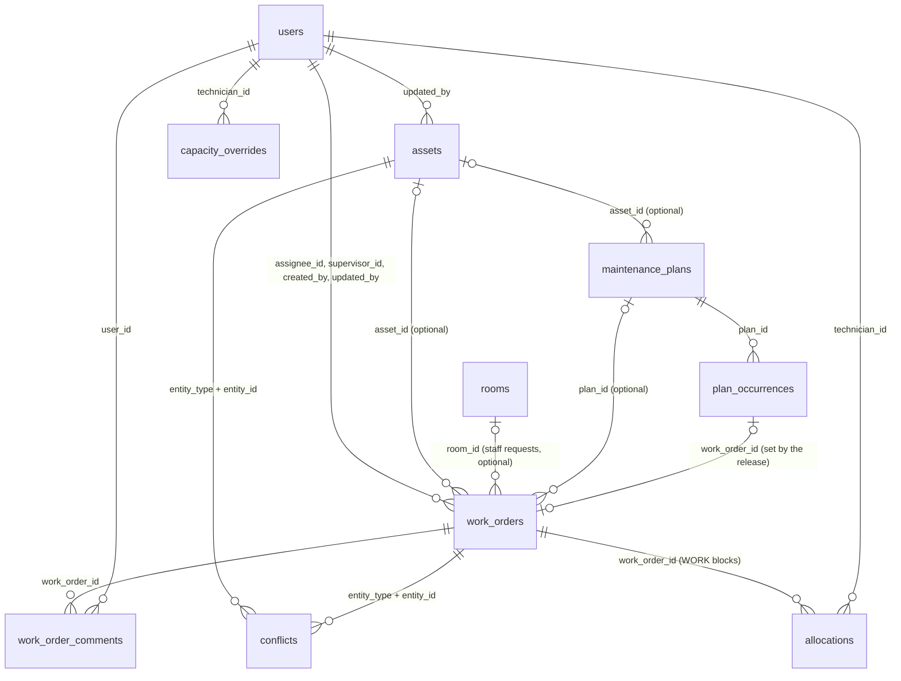
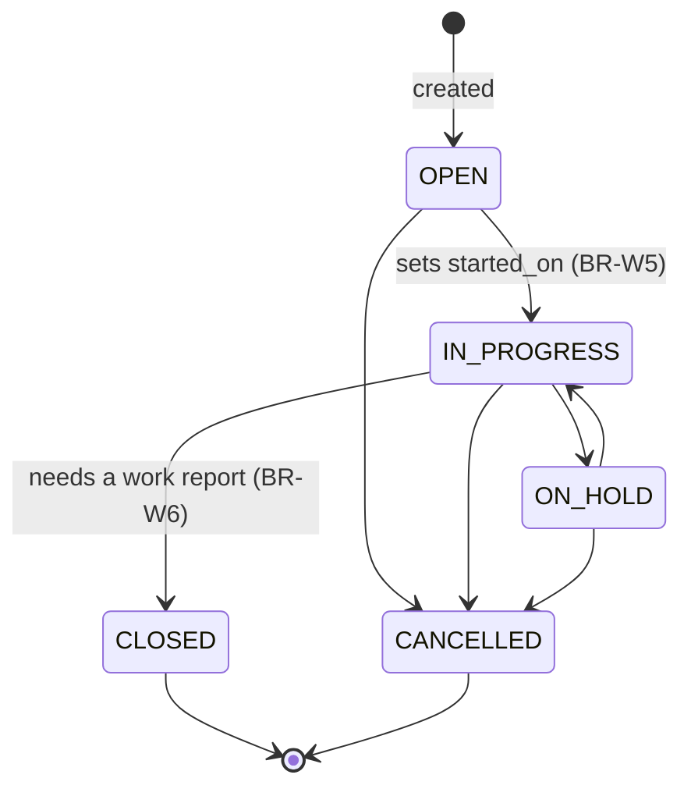

# Data Model

Database: **SQLite** (one file, path from `DATABASE_PATH`), accessed with `better-sqlite3`. Schema changes are plain numbered SQL files in `backend/src/db/migrations/` (`001_init.sql`, `002_...sql`), applied in order by a small runner that records them in `schema_migrations`.

Connection pragmas, set on every open: `journal_mode = WAL`, `foreign_keys = ON`, `busy_timeout = 5000`, `synchronous = NORMAL`.

Conventions:
- Primary keys: `INTEGER PRIMARY KEY AUTOINCREMENT`.
- Datetimes (`*_at`): `TEXT`, ISO 8601 UTC with milliseconds (`2026-10-04T08:15:30.123Z`), set by the application. Dates (`*_on`): `TEXT` `YYYY-MM-DD`.
- Booleans: `INTEGER` 0/1 in the database, `true`/`false` in JSON.
- Names are English `snake_case`. Enumerated values are `UPPER_SNAKE_CASE` codes; the UI shows labels (D16).
- Columns added to the brief are marked **(added)** with the decision ID in `docs/decisions.md`.

## Entity overview

## Enumerated values

| Enum | Codes (UI label) |
|---|---|
| Role | `STAFF` (Staff), `TECHNICIAN` (Technician), `SUPERVISOR` (Supervisor), `ADMIN` (Administrator) |
| Category | `HVAC` (HVAC), `ELECTRICAL` (Electrical), `FIRE_SAFETY` (Fire safety), `PLUMBING` (Plumbing), `NETWORK_CABLING` (Network cabling), `SECURITY` (Security) |
| Criticality | `LOW`, `MEDIUM`, `HIGH`, `CRITICAL` |
| Asset status | `IN_SERVICE` (In service), `BROKEN_DOWN` (Broken down), `UNDER_MAINTENANCE` (Under maintenance), `OUT_OF_SERVICE` (Out of service) |
| Work order type | `CORRECTIVE`, `PREVENTIVE`, `IMPROVEMENT`, `REGULATORY` |
| Work order status | `OPEN` (Open), `IN_PROGRESS` (In progress), `ON_HOLD` (On hold), `CLOSED` (Closed), `CANCELLED` (Cancelled) |
| Work order priority | `LOW`, `NORMAL`, `HIGH`, `URGENT` |
| Conflict status | `OPEN`, `RESOLVED` |
| Review status (D47) | `PENDING` (To review), `APPROVED` (Approved), `REJECTED` (Rejected), `WITHDRAWN` (Withdrawn: cancelled by the requester, D79) |
| Conflict resolution | `A`, `B`, `MERGE` |
| Plan type (D48) | `PREVENTIVE`, `REGULATORY` (the work order type of the visits) |
| Schedule mode (D48) | `FIXED` (Fixed calendar), `FLOATING` (From the last visit) |
| Performed by (D48) | `INTERNAL` (Internal team), `CONTRACTOR` (Contractor) |
| Occurrence status (D48) | `PLANNED` (Planned), `RELEASED` (Work order created), `SKIPPED` (Skipped) |
| Allocation kind (D52) | `WORK` (Work), `TRAVEL` (Travel), `PREPARATION` (Preparation), `OTHER` (Other time) |
| Capacity reason (D52) | `LEAVE` (Leave), `PART_TIME` (Part time), `TRAINING` (Training), `WEEKEND` (Weekend work), `OTHER` (Other) |

- Terminal work order statuses: `CLOSED`, `CANCELLED`. Non-terminal: `OPEN`, `IN_PROGRESS`, `ON_HOLD`.
- `FIRE_SAFETY` is the fire detection and alarm system; `NETWORK_CABLING` covers voice, data and video cabling.
- The values are defined once per side: `backend/src/rules/enums.js` and `frontend/assets/js/enums.js` (labels in `frontend/assets/js/labels.js`). Both must match this table.
- In the database, every enumerated column has a `CHECK (col IN (...))` constraint (D6).

## Tables

### users
| Column | Type | Null | Constraints / default | Notes |
|---|---|---|---|---|
| id | INTEGER | no | PK | |
| last_name | TEXT | no | | |
| first_name | TEXT | no | | |
| username | TEXT | no | UNIQUE (stored lowercase) | |
| password_hash | TEXT | no | | argon2 **(added, D1)** |
| role | TEXT | no | CHECK Role | |
| site | TEXT | yes | | |
| specialty | TEXT | yes | CHECK Category | |
| power_user | INTEGER | no | default 0 | enables auto-save mode (D21) |
| is_active | INTEGER | no | default 1, CHECK 0/1 | inactive users cannot log in **(added, D39)** |
| credentials_changed_at | TEXT | yes | | last password change; older tokens are refused **(added, D39)** |
| created_at / updated_at | TEXT | no | default now | **(added)** |

### assets
| Column | Type | Null | Constraints / default | Notes |
|---|---|---|---|---|
| id | INTEGER | no | PK | |
| code | TEXT | no | UNIQUE | e.g. `AST-0001`; immutable |
| name | TEXT | no | | e.g. "Fan coil unit, floor 3" |
| site | TEXT | no | | |
| building | TEXT | yes | | |
| floor | TEXT | yes | | e.g. `L3` |
| category | TEXT | no | CHECK Category | |
| subcategory | TEXT | yes | | |
| criticality | TEXT | no | CHECK Criticality | |
| status | TEXT | no | CHECK Asset status | |
| brand | TEXT | yes | | |
| model | TEXT | yes | | |
| serial_number | TEXT | yes | | |
| commissioned_on | TEXT | yes | | date |
| last_serviced_on | TEXT | yes | | date |
| supplier | TEXT | yes | | |
| maintenance_contract | INTEGER | no | default 0 | boolean |
| responsible_technician | TEXT | yes | | free text (D5) |
| exact_location | TEXT | yes | | |
| comment | TEXT | yes | | |
| version | INTEGER | no | default 1 | optimistic concurrency **(added, D2)** |
| has_conflict | INTEGER | no | default 0 | 1 while a conflict is open **(added, D2)** |
| updated_by | INTEGER | yes | FK → users.id | last writer **(added, D2)** |
| created_at / updated_at | TEXT | no | default now | |

Indexes: `code` (unique), `site`, `category`, `status`, `updated_at`.

### work_orders
| Column | Type | Null | Constraints / default | Notes |
|---|---|---|---|---|
| id | INTEGER | no | PK | |
| number | TEXT | no | UNIQUE | e.g. `WO-2026-00001`; generated by the server at creation (BR-W10); immutable |
| client_id | TEXT | yes | UNIQUE | UUID generated by the client for idempotent creation **(added, D26)**; null for seeded rows |
| type | TEXT | no | CHECK Work order type | |
| status | TEXT | no | CHECK Work order status | |
| priority | TEXT | no | CHECK Work order priority | |
| title | TEXT | no | | |
| description | TEXT | yes | | |
| asset_id | INTEGER | yes | FK → assets.id | optional (brief) |
| site | TEXT | no | | equals the asset's site when `asset_id` is set |
| location | TEXT | yes | | where exactly, free text ("Tower A, floor 12, desk 12-21"); given by staff requests **(added, D46)**; with a room, only the details ("desk 12-21") |
| room_id | INTEGER | yes | FK → rooms.id | the room a staff request was sent from; NULL when none was picked **(added, D81, `014`)**; read-only for the team |
| category | TEXT | yes | CHECK Category | technical trade |
| assignee_id | INTEGER | yes | FK → users.id | (D5) |
| supervisor_id | INTEGER | yes | FK → users.id | (D5) |
| created_on | TEXT | no | | date |
| due_on | TEXT | yes | | date |
| started_on | TEXT | yes | | date |
| closed_on | TEXT | yes | | date |
| estimated_hours | REAL | yes | CHECK ≥ 0 | |
| actual_hours | REAL | yes | CHECK ≥ 0 | |
| work_report | TEXT | yes | | |
| created_by | INTEGER | no | FK → users.id | author **(added, D25)** |
| review_status | TEXT | yes | CHECK Review status; `PENDING` only while `OPEN` and unassigned; `REJECTED` and `WITHDRAWN` only when `CANCELLED` | NULL except for staff requests **(added, D47; `WITHDRAWN` added by 013, D79)** |
| reviewed_by | INTEGER | yes | FK → users.id | supervisor or admin who reviewed **(added, D47)** |
| reviewed_at | TEXT | yes | | datetime of the review **(added, D47)** |
| review_note | TEXT | yes | | reason of a rejection, shown to the requester **(added, D47)** |
| plan_id | INTEGER | yes | FK → maintenance_plans.id | the plan of a preventive visit; set by the release, read-only **(added, D48)** |
| planned_week | TEXT | yes | ISO week `YYYY-Www` | week the work is planned in; set by the release, or by the week scheduler with the first block (D52); rescheduled by supervisors and admins in `PUT` (D55) **(added, D48)** |
| version | INTEGER | no | default 1 | |
| has_conflict | INTEGER | no | default 0 | |
| updated_by | INTEGER | yes | FK → users.id | **(added, D2)** |
| created_at / updated_at | TEXT | no | default now | |

Indexes: `number` (unique), `client_id` (unique), `status`, `asset_id`, `assignee_id`, `created_on`, `updated_at`, (`created_by`, `created_at`) for "my requests", partial index on `review_status` `WHERE review_status = 'PENDING'` (dashboard tile), `plan_id`, `planned_week`.

### conflicts (added, D3)
| Column | Type | Null | Constraints / default | Notes |
|---|---|---|---|---|
| id | INTEGER | no | PK | |
| entity_type | TEXT | no | CHECK IN (`assets`, `work_orders`) | |
| entity_id | INTEGER | no | | id in the entity table |
| base_version | INTEGER | no | | version the client edited from |
| server_version | INTEGER | no | | version in the database when the conflict occurred |
| server_snapshot | TEXT | no | | JSON of the server record at that time ("version A") |
| client_changes | TEXT | no | | JSON of the fields the client tried to change ("version B") |
| server_updated_by | INTEGER | yes | FK → users.id | author of version A |
| server_updated_at | TEXT | no | | timestamp of version A |
| client_user_id | INTEGER | no | FK → users.id | author of version B |
| client_edited_at | TEXT | no | | when the client made the edit (may be earlier than the submission if it was queued offline) |
| status | TEXT | no | CHECK Conflict status, default `OPEN` | |
| resolution | TEXT | yes | CHECK Conflict resolution | |
| resolved_by | INTEGER | yes | FK → users.id | |
| resolved_at | TEXT | yes | | |
| created_at | TEXT | no | default now | |

Indexes: unique partial index on (`entity_type`, `entity_id`) `WHERE status = 'OPEN'` (at most one open conflict per record, D4); `status`.

### audit_log (added, D37)
| Column | Type | Null | Constraints / default | Notes |
|---|---|---|---|---|
| id | INTEGER | no | PK | |
| entity_type | TEXT | no | CHECK IN (`assets`, `work_orders`, `users`, `maintenance_plans`, `plan_occurrences`, `allocations`, `planning_settings`) | planning records since `008` (D48); blocks of the week scheduler since Phase 19 |
| entity_id | INTEGER | no | | id of the record (kept after deletion) |
| action | TEXT | no | CHECK IN (`CREATE`, `UPDATE`, `DELETE`, `CONFLICT`, `RESOLVE`) | |
| changes | TEXT | no | JSON, default `{}` | `{ field: { from, to } }` in API values |
| note | TEXT | yes | JSON | e.g. `{ conflict_id, choice }`; for `DELETE`, the last values (`snapshot`) |
| label | TEXT | no | | record label at the time (`AST-0042 — Chiller`) |
| user_id | INTEGER | yes | FK → users.id | author |
| version | INTEGER | yes | | record version after the change |
| at | TEXT | no | default now | |

Indexes: (`entity_type`, `entity_id`, `at`), `at`.

Rules:
- BR-L1: Every change writes its entry **in the same transaction**: a change without its entry, or an entry without its change, cannot exist. Rows are never updated or deleted.
- BR-L2: `UPDATE` entries list only fields whose value really changed; a save that changes nothing writes no entry. `CREATE` lists every field that has a value.
- BR-L3: A rejected conflicting edit is logged as `CONFLICT` (changes proposed, not applied) by its author; its resolution as `RESOLVE` (changes applied, choice in `note`) by the supervisor.
- BR-L4: The mock data comes with a matching history: creation of every asset and work order, and the status changes of each work order.

### Full-text indexes (added, D38)
`assets_fts` and `work_orders_fts` (migration `003_search.sql`; `location` added to `work_orders_fts` by `006`): FTS5 external-content tables over the text columns listed in `docs/api-design.md` → Search and filters, kept in sync by `AFTER INSERT/UPDATE/DELETE` triggers on `assets` and `work_orders`.

### feedback (added, D40)
Improvement ideas sent from the pages of the tool (migration `005_feedback.sql`).

| Column | Type | Null | Constraints / default | Notes |
|---|---|---|---|---|
| id | INTEGER | no | PK | |
| message | TEXT | no | 1 to 2000 characters | |
| page_path | TEXT | no | starts with `/`, ≤ 500 | path and query of the page |
| page_title | TEXT | no | ≤ 200 | page title, and the record open in the side panel |
| viewport_width | INTEGER | yes | 1 to 20000 | screen width in CSS pixels |
| user_id | INTEGER | no | FK → users.id | author |
| user_role | TEXT | no | CHECK Role | role when sent (`STAFF` allowed since `006`) |
| status | TEXT | no | CHECK FeedbackStatus, default `NEW` | `NEW`, `PLANNED`, `DONE`, `DECLINED` |
| created_at / updated_at | TEXT | no | | |
| updated_by | INTEGER | yes | FK → users.id | last status change |

Indexes: `created_at`, (`status`, `created_at`).

### work_order_comments (added, D46)
The conversation of a work order between the requester and the maintenance team (migration `006_staff_requests.sql`). Append-only: comments are never edited or deleted.

| Column | Type | Null | Constraints / default | Notes |
|---|---|---|---|---|
| id | INTEGER | no | PK | |
| work_order_id | INTEGER | no | FK → work_orders.id | |
| user_id | INTEGER | no | FK → users.id | author |
| user_role | TEXT | no | CHECK Role | role when written |
| body | TEXT | no | 1 to 2000 characters (trimmed) | |
| created_at | TEXT | no | | |

Index: (`work_order_id`, `created_at`).

Migration `006` also rebuilt `users` and `feedback` to add `STAFF` to their role `CHECK` (SQLite cannot alter a constraint), and added `location` to the work order search index. The migration runner turns foreign keys off while migrations run and runs `PRAGMA foreign_key_check` before each commit.

### rooms (added, D81)
The rooms staff pick from when they send a request (migration `014_rooms.sql`). Kept by supervisors and admins; never deleted, only taken out of use.

| Column | Type | Null | Constraints / default | Notes |
|---|---|---|---|---|
| id | INTEGER | no | PK | |
| site | TEXT | no | 1 to 200 characters | set at creation, never changed (BR-RM2) |
| building | TEXT | no | 1 to 100 characters | e.g. `Tower A` |
| floor | TEXT | no | 1 to 50 characters | same convention as the assets: `B1` (first basement), `L0` (ground floor), `L12` |
| name | TEXT | no | 1 to 100 characters | e.g. `Meeting room 12.02` |
| is_active | INTEGER | no | 0/1, default 1 | 0 = no longer offered to staff (BR-RM3) |
| created_by, updated_by | INTEGER | yes | FK → users.id | NULL for the seeded rooms |
| created_at, updated_at | TEXT | no | | |

Index: unique (`site`, `building`, `floor`, `name`), case-insensitive (BR-RM1). Room changes are not in the audit log: like the widget settings, the list is reference data, and a work order keeps the room it names. Room names are not in the work order search index.

### schema_migrations
| Column | Type | Notes |
|---|---|---|
| name | TEXT PK | migration file name |
| applied_at | TEXT | |

### Preventive maintenance (added, D48, D49)
Migrations `008_preventive_maintenance.sql` (Phase 17), `009_planner_editing.sql` (Phase 18) and `010_week_scheduler.sql` (Phase 19). Weeks are **ISO weeks** (Monday to Sunday) written `YYYY-Www` (`2026-W43`), in `APP_TIMEZONE`; some years have 53 weeks (2026 does), and frequencies simply run through them. Week columns have `CHECK (… GLOB '[0-9][0-9][0-9][0-9]-W[0-5][0-9]')`; the API also refuses weeks that do not exist (`2027-W53`). Days are dates `YYYY-MM-DD` (`CHECK (… GLOB '[0-9][0-9][0-9][0-9]-[0-9][0-9]-[0-9][0-9]')`).

#### maintenance_plans
A recurring preventive task: what, where, which trade, how long, how often.

| Column | Type | Null | Constraints / default | Notes |
|---|---|---|---|---|
| id | INTEGER | no | PK | |
| code | TEXT | no | UNIQUE, `PM-` + digits | automatic: `PM-` + the next number, at least 4 digits |
| title | TEXT | no | 1–200 | "Quarterly service, Tower A chiller" |
| description | TEXT | yes | ≤ 4000 | instructions for the technician |
| type | TEXT | no | CHECK Plan type | work order type of the visits |
| category | TEXT | no | CHECK Category | trade; defaults to the asset's |
| asset_id | INTEGER | yes | FK → assets.id | the asset maintained, if one |
| site | TEXT | no | | the asset's site when `asset_id` is set (BR-P9) |
| building | TEXT | yes | | the asset's building when `asset_id` is set (BR-P9) |
| location | TEXT | yes | ≤ 200 | free text, as on work orders |
| estimated_hours | REAL | no | > 0, ≤ 200, multiple of 0.5 | per visit |
| frequency_weeks | INTEGER | no | 1–104 | 1, 2, 4, 8, 13, 26, 52 are offered first |
| anchor_week | TEXT | no | ISO week | first visit of the series |
| end_week | TEXT | yes | ISO week, ≥ anchor (API) | contract end; open-ended when NULL |
| schedule_mode | TEXT | no | CHECK Schedule mode, default `FIXED` | BR-P5 |
| tolerance_weeks | INTEGER | no | 0–8 | default `min(8, floor(frequency_weeks / 4))`; how far one visit may move (BR-P3) |
| season_from_week, season_to_week | INTEGER | yes | 1–53, both or neither | allowed season; may wrap over the new year (45 → 10) |
| performed_by | TEXT | no | CHECK Performed by, default `INTERNAL` | |
| supplier | TEXT | yes | required by the API for `CONTRACTOR` | contractor name |
| is_active | INTEGER | no | 0/1, default 1 | inactive plans keep their history and create nothing |
| version | INTEGER | no | default 1 | optimistic check: 409 when stale, no conflict console |
| created_by / updated_by | INTEGER | no / yes | FK → users.id | |
| created_at / updated_at | TEXT | no | | |

Indexes: `code` (unique), (`site`, `building`), `category`, `is_active`.

#### plan_occurrences
One visit of a plan in a week.

| Column | Type | Null | Constraints / default | Notes |
|---|---|---|---|---|
| id | INTEGER | no | PK | |
| plan_id | INTEGER | no | FK → maintenance_plans.id | |
| due_week | TEXT | no | ISO week | week given by the series |
| week | TEXT | no | ISO week | planned week; differs from `due_week` once moved |
| status | TEXT | no | CHECK Occurrence status, default `PLANNED` | |
| work_order_id | INTEGER | yes | FK → work_orders.id, UNIQUE | set by the release |
| skip_reason | TEXT | yes | required when `SKIPPED` | |
| moved_by / moved_at | | yes | | last single move; cleared when the visit goes back to its due week |
| version | INTEGER | no | default 1 | moves, skips and restores are checked against it (409 when stale); the release and the series changes increase it too (`009`) |
| created_at / updated_at | TEXT | no | | |

Constraints: UNIQUE (`plan_id`, `due_week`); `RELEASED` ⇒ `work_order_id` set; `PLANNED` ⇒ no `work_order_id` (a visit skipped by cancelling its work order keeps the link, D49). Indexes: `week`, (`plan_id`, `week`).

#### blocked_weeks (`009`)
Weeks visits should avoid (a data center change freeze, the summer holidays): `id`, `week` (ISO week), `site` (NULL = every site), `reason` (1–200), `created_by`, `created_at`. Unique per week and site, "every site" counted once (unique index on `week, coalesce(site, '')`). The planner warns, it never refuses (BR-P8). Not in the audit log.

#### allocations (`010`, D52)
A block of hours of one person on one day: work on a work order, or travel, preparation or other time. No clock time, except an appointment.

| Column | Type | Null | Constraints / default | Notes |
|---|---|---|---|---|
| id | INTEGER | no | PK | |
| kind | TEXT | no | CHECK Allocation kind | |
| work_order_id | INTEGER | yes | FK → work_orders.id | set ⇔ `kind = WORK` |
| technician_id | INTEGER | no | FK → users.id | an active technician or supervisor (API) |
| day | TEXT | no | date | |
| hours | REAL | no | 0.5–8, multiple of 0.5 | the API keeps it ≤ `max_block_hours` (3.5 h, BR-S1) |
| locked_start | TEXT | yes | `HH:MM` on the half hour, `WORK` only | appointment (P6) |
| locked_by | INTEGER | yes | FK → users.id | set ⇔ `locked_start` set |
| position | INTEGER | yes | | the person's own order in the day (BR-S7) |
| note | TEXT | yes | ≤ 500 | "Keys at reception", "Lyon → Saclay" |
| version | INTEGER | no | default 1 | moves, resizes, notes and locks are checked against it (409 when stale) |
| created_by / updated_by | INTEGER | no / yes | FK → users.id | |
| created_at / updated_at | TEXT | no | | |

Indexes: (`technician_id`, `day`), `work_order_id`, `day`. Logged in `audit_log` (`entity_type = allocations`); the day order is not.

#### capacity_overrides (`010`)
A person's hours on one day when they differ from the default (P5): `technician_id` (FK), `day`, `hours` (0–12 in half hours; 0 = absent), `reason` (CHECK Capacity reason), `note` (≤ 200), `updated_by`, `updated_at`. PK (`technician_id`, `day`). Without an override: `daily_hours` Monday to Friday, 0 on Saturday and Sunday. Not logged.

#### schedule_weeks (`010`)
Weekend days opened for a week (P11): `week` (PK, ISO week), `saturday_open`, `sunday_open` (0/1, default 0), `updated_by`, `updated_at`. No row: Monday to Friday. An open weekend day appears in the grid with 0 h until a person gets hours with a `WEEKEND` override. Not logged.

#### planning_settings
One row (`id = 1`), edited by the administrators (P16): `daily_hours` (default 7; 0.5–12 in half hours), `reserve_percent` (30; 0–80), `release_weeks_ahead` (4; 1–12), `max_block_hours` (3.5; 0.5–8 in half hours), `version`, `updated_by`, `updated_at`. Every change is logged (`entity_type = planning_settings`).

### dashboards (added, D59, Phase 21)

Personal dashboards of supervisors and admins (migration `011_dashboards.sql`; `docs/spec-dashboards.md`).

| Column | Type | Null | Constraints / default | Notes |
|---|---|---|---|---|
| id | INTEGER | no | PK | |
| user_id | INTEGER | no | FK → users.id | owner (BR-K1) |
| name | TEXT | no | 1–60 characters, trimmed | unique per user ignoring case: unique index on (`user_id`, `name COLLATE NOCASE`); the API also compares accented letters (BR-K2) |
| position | INTEGER | no | | order in the sidebar |
| widgets | TEXT | no | JSON array, default `[]` | `[{ "key": "by_status", "options": {} }, …]` in display order; keys from the catalogue, each once (BR-K3); no widget has options yet |
| filters | TEXT | no | JSON object, default `{}` | `{ "period": 30 \| 90 \| 365, "sites": [string], "categories": [Category] }` |
| version | INTEGER | no | default 1 | optimistic check: 409 when stale (one owner: no conflict console) |
| created_at / updated_at | TEXT | no | | |

Index: (`user_id`, `position`). Not in the audit log (personal preferences). A user without dashboards gets "Overview" (every widget) on their first `GET /api/dashboards`.

#### widget_settings (`012`, D65)
Dashboard widgets switched on or off for supervisors by the administrators: `key` (PK, a key of the widget catalogue, checked by the API), `enabled` (0/1), `updated_by` (FK → users.id, null for a row written by a migration), `updated_at`. No row: the widget is on. A widget switched off is hidden from supervisors (sidebar, dashboards, figures, records, drill-down) and cannot be added by them; it stays stored on their dashboards. Administrators see every widget. Not logged.

Rules: BR-K1 a dashboard is only seen and changed by its owner (404 for others); BR-K2 1 to 20 dashboards per user, names unique ignoring case, the last one cannot be deleted; BR-K3 widget keys known and each at most once; BR-K4 the Work orders (CSV) of a widget lists exactly the records its figures count (one WHERE clause per widget in `services/dashboard-widgets.js`).

## Business rules

### Users and authentication
- BR-U1: `username` is unique and case-insensitive (stored lowercase).
- BR-U2: Passwords are hashed with argon2; minimum length 10.
- BR-U3: Administrators create and edit users (D39). The `username` never changes; users are deactivated, never deleted.
- BR-U4: At least one active administrator always remains: the last one cannot be deactivated or given another role (409).
- BR-U5: A user with unfinished work orders (`OPEN`, `IN_PROGRESS`, `ON_HOLD`) assigned to them cannot be deactivated; reassign them first (409). Only active users can be assigned work (BR-W3).
- BR-U6: Administrators cannot deactivate their own account (409).
- BR-U7: An inactive user cannot log in (same answer as wrong credentials) and their existing tokens are refused at once (401).
- BR-U8: Setting a password (admin reset or own change) sets `credentials_changed_at`: tokens issued before it are refused (401). Changing one's own password requires the current one and returns a new token for the current session.

### Versioning and conflicts (both entities)
- BR-V1: Every update request carries the `version` the client edited from. A missing `version` is rejected (400).
- BR-V2: If the request's `version` equals the stored `version`: apply the changes, `version = version + 1`, set `updated_at` and `updated_by`, in one transaction.
- BR-V3: If it differs: in one transaction, insert a `conflicts` row (version A = current server record, version B = client changes), set the entity's `has_conflict = 1` and its `updated_at` (but not `version`), and answer 409.
- BR-V4: While `has_conflict = 1`, every regular update is rejected with 409 and `locked: true` (D4).
- BR-V5: Resolution (supervisor or admin only) applies version A, version B, or a merged set of fields. Then `version = version + 1`, `has_conflict = 0`, and the `conflicts` row is marked `RESOLVED` with `resolution`, `resolved_by` and `resolved_at`, all in one transaction.
- BR-V6: The fields shown as "divergent" in arbitration are those in `client_changes` whose value differs from `server_snapshot`.

### Assets
- BR-A1: `code` is unique and immutable.
- BR-A2: Fields editable per role are listed in `docs/api-design.md` (permission matrix).
- BR-A3: Deleting an asset is for records created by mistake: only assets without any work order (open or closed) can be deleted, at the version the user saw, and without an open conflict. Otherwise 409: an asset with maintenance history is set `OUT_OF_SERVICE` instead. Resolved conflicts of a deleted asset are deleted with it.
- BR-A4: At creation, `code` is optional. When left out, the server gives `AST-` + the next number after the highest existing `AST-<digits>` code (at least 4 digits). A typed code is stored in capitals, must match `[A-Z0-9][A-Z0-9-]{1,49}`, and must be unused (409). Required: `name`, `site`, `category`, `criticality`; `status` defaults to `IN_SERVICE`.

### Work orders
- BR-W1: `number` is unique and immutable; format `WO-YYYY-NNNNN` (see BR-W10).
- BR-W2: If `asset_id` is set, it must reference an existing asset, and `site` takes the asset's site. Sending a different `site` together with an asset is refused (422).
- BR-W3: `assignee_id` must reference an active user with role `TECHNICIAN` or `SUPERVISOR`; `supervisor_id` a user with role `SUPERVISOR` or `ADMIN`.
- BR-W4: Allowed status transitions (any other is rejected with 422):

| From | To |
|---|---|
| OPEN | IN_PROGRESS, CANCELLED |
| IN_PROGRESS | ON_HOLD, CLOSED, CANCELLED |
| ON_HOLD | IN_PROGRESS, CANCELLED |
| CLOSED | (terminal) |
| CANCELLED | (terminal) |

- BR-W5: Entering `IN_PROGRESS` for the first time sets `started_on` to today if it is empty.
- BR-W6: Entering `CLOSED` requires a non-empty `work_report` (already stored or sent in the same request) and sets `closed_on` to today if empty.
- BR-W7: Terminal work orders are read-only (except for conflict resolution).
- BR-W8: `due_on`, if set, is not earlier than `created_on`. `closed_on`, if set, is not earlier than `started_on`.

### Work order creation (D15, D25–D27)
- BR-W9: Required at creation: `title`, `type`, `client_id`, and either `asset_id` or `site`. Defaults: `priority = NORMAL`; `category` = the asset's category when an asset is given and no category is sent. The server sets `status = OPEN`, `created_by` = current user, `version = 1`, and `created_on` = the date (in `APP_TIMEZONE`) of the client's `edited_at`, i.e. when the user actually created it, which may be earlier than the sync for offline creations. `edited_at` defaults to now and must be neither in the future (1 min tolerance) nor more than 30 days old (422). The client can't send `status`, `created_on`, `created_by`, `version` or `number`.
- BR-W10: `number` = `WO-` + year of `created_on` + `-` + the next 5-digit sequence for that year (`MAX` of that year's numbers + 1, computed inside the insert transaction; SQLite allows one writer at a time, so two creations can't get the same number). The sequence restarts at `00001` each year.
- BR-W11: A `POST` whose `client_id` already exists returns the existing work order (no new row), so retrying a queued creation never creates a duplicate.
- BR-W12: A `TECHNICIAN` creating a work order: `assignee_id` is set to themselves, and sending another `assignee_id` or a `supervisor_id` is rejected (403). `SUPERVISOR` and `ADMIN` may set both or leave them empty.
- BR-W13: BR-W2, BR-W3 and BR-W8 apply at creation (so `due_on` can't be earlier than `created_on`).

### Staff requests (D46)
- BR-R1: A request is a work order created by a `STAFF` user through `POST /api/requests`. Required: `client_id`, `title`, `site`, and a place: a room of the list (`room_id`), a `location` in words, or both (D81). Optional: `description`, `category`, `priority` ("I don't know" in the form = left out: no category, priority `NORMAL`). The server sets `type = CORRECTIVE`, no assignee, no supervisor, no asset; BR-W9 to BR-W11 apply (number, creation date, idempotent `client_id`).
- BR-R2: Staff see only the work orders they created (`created_by`); another work order answers 404, so its existence is not revealed. They cannot read or write any other business data (403), except the reference data (site list), their account and suggestions.
- BR-R3: Staff are never assignees or supervisors (BR-W3 already limits these to maintenance roles).
- BR-R4: Comments: the requester comments on their own requests; maintenance roles comment on any work order. 1 to 2000 characters. A comment does not change the work order (`version`, `updated_at`), so it never causes a conflict.
- BR-R5: The status steps shown to the requester come from the audit log: the creation, the review (`APPROVED` or `REJECTED`, from the entry's `note.review`) and each applied status change (`CONFLICT` entries changed nothing and are skipped).
- BR-R6 (D47): A new request has `review_status = PENDING`. Only a `PENDING` request can be reviewed, once (409 otherwise; 422 for a work order that is not a staff request), by a `SUPERVISOR` or `ADMIN`, at the version they saw (409 `BR-V1`) and without an open conflict (409 `BR-V4`).
- BR-R7: While `PENDING`, a regular update (or a conflict resolution) cannot change `status` or `assignee_id` (422): the request is assigned by approving it and cancelled by rejecting it.
- BR-R8: Rejecting sets `status = CANCELLED`, `review_status = REJECTED` and `review_note` (the reason, 1 to 2000 characters, required).
- BR-R9: Approving requires an `assignee_id` (BR-W3: an active technician or supervisor) and sets `review_status = APPROVED`; `supervisor_id` defaults to the reviewer. `type`, `priority`, `category` and `due_on` (BR-W8) may be set in the same request. Both decisions increment `version`, set `reviewed_by`, `reviewed_at`, `updated_by`, `updated_at`, and write one `UPDATE` audit entry with `note: { review: "APPROVED" | "REJECTED" }`, in one transaction.
- BR-R10 (D79): The requester may cancel their own request while it is `OPEN`, reviewed or not (`POST /api/requests/:id/cancel`, no version: staff never see it). It sets `status = CANCELLED` and `review_status = WITHDRAWN`, keeps the review fields of an approved request, increments `version`, sets `updated_by` and `updated_at`, and writes one `UPDATE` audit entry, in one transaction. Refused with 422 once work has started (`IN_PROGRESS`, `ON_HOLD`) or when the request is finished, and with 409 (`BR-V4`) while a conflict is open. A maintenance edit made from an older version then becomes a conflict (BR-V3). The status steps (BR-R5) show it as one step, `WITHDRAWN`.

- BR-RM1: A room has a building, a floor and a name; two rooms of a site cannot share them, whatever the case (409).
- BR-RM2: A room's site is set at creation and never changes: a room on another site is a new room.
- BR-RM3: Rooms are never deleted. A room taken out of use (`is_active = 0`) is no longer offered to staff; the requests sent from it keep it.
- BR-RM4: A request may only name an active room of its own site (422 otherwise).
### Preventive maintenance (D48, D49)
- BR-P1: A plan's visits fall in `anchor_week + k × frequency_weeks` (k ≥ 0), up to `end_week` if set. Occurrences are stored from the current week to 104 weeks ahead; the daily release tops them up.
- BR-P2 (D51): Changing the series (anchor, frequency, end) or reactivating a plan replaces the occurrences still `PLANNED` and never moved. When the anchor moves at the same frequency, the series **shifts**: a visit moved by hand moves by the same number of weeks (keeping its own offset); a visit with a work order, or skipped, keeps its week but its `due_week` follows the series when it is still to come, so it holds its slot and no second visit is planned next to it. A moved visit whose due week leaves the series, lands in the past or meets a taken slot is removed. When the frequency changes, the series is rebuilt (no shift). A `FLOATING` restart (BR-P5) is a rebuild too. Deactivating removes every `PLANNED` occurrence.
- BR-P3: One visit moves within `due_week ± tolerance_weeks`, never before the current week; a `REGULATORY` visit only earlier (its due week is a legal deadline). Otherwise 422 with the reason ("Week 1 is outside this visit's tolerance of ± 3 weeks around week 50.", "A regulatory visit can only move earlier: week 50 is its deadline."). Back on its due week, it is no longer a moved visit.
- BR-P4: A visit with a work order is not moved in the year planner (422): its work order is rescheduled instead (D55), through its `planned_week` (the work order form) or the week scheduler (D52). Changing the `planned_week` of a released visit's work order moves the visit's `week` too (a moved visit, unless back on its due week; logged on the visit, `note: { work_order }`), without the tolerance; it cannot be cleared (422 `BR-P4`), and a regulatory visit cannot go past its due week (422 `BR-P3`).
- BR-P5: `FIXED` plans keep their calendar. In a `FLOATING` plan, closing a visit's work order moves the anchor to the closing week + the frequency (logged on the plan) and replaces the planned visits.
- BR-P6: The release creates the work order of every `PLANNED` occurrence of an active plan whose week is at most `release_weeks_ahead` weeks after the current week, one transaction per occurrence; a second run creates nothing (the occurrence is no longer `PLANNED`, and `work_order_id` is UNIQUE). The work order takes the plan's type, title (+ " – 2026-W43"), description, asset, site, location, trade and hours, with `status = OPEN`, `priority = NORMAL`, no assignee, `created_on` = today, `due_on` = the Friday of the week (today when late), `plan_id`, `planned_week`, and the plan's author (or the user who asked for the release) as `created_by`.
- BR-P7: A planned visit is skipped with a reason (1–500) and leaves the load; it can be restored (back to `PLANNED`). A visit with a work order is skipped only by cancelling its work order, which skips it with the reason "Work order WO-… cancelled"; that skip cannot be undone (422).
- BR-P8: Warnings, never refusals: a visit longer than `max_block_hours` (`LONG_VISIT`, "will be split"), a visit outside the plan's season (`OUT_OF_SEASON`), a visit in a week blocked for its site or every site (`BLOCKED_WEEK`), a week over capacity.
- BR-P9: With an asset, a plan's `site` and `building` are the asset's; sending others is refused (422), as is an unknown asset. The trade defaults to the asset's.

### Year planner figures (D48)
- BR-Y1: Planned hours of a week = estimated hours of the internal occurrences whose `week` is that week, released ones included, skipped ones excluded; per trade and per site.
- BR-Y2: Weekly capacity = Σ over active technicians **and supervisors** of `daily_hours` × 5 working days, minus `reserve_percent`; per trade through `specialty` (`GENERAL` without one) and per site. The site and trade filters narrow it to those people (D49).
- BR-Y3: Load = planned hours ÷ capacity; above 100 %: over capacity; 85 % to 100 %: tight; no load without capacity.
- BR-Y4: Contractor visits are counted per week, never in the load.

### Balancing assistant (D48, D53)
- BR-B1: The assistant proposes moves of single visits: planned (`PLANNED`) visits of active internal plans, in the weeks shown and for the filters in use; at most 30 at a time. Asking saves nothing.
- BR-B2: A visit is only proposed to a week its own move allows (BR-P3: within its tolerance, only earlier for a regulatory visit), after the release horizon (a visit moved into it would get its work order at the next timeline load and could no longer move back), inside its plan's season, outside the weeks blocked for its site or every site, and never a week where its plan already has a visit.
- BR-B3: Moves are chosen one at a time, the one that lowers the most the sum of squared weekly loads plus the sum of squared weekly loads of the visit's trade (trades without capacity left out); a move never fills a week above where the week it leaves was, so the peak never rises; each visit moves once at most.
- BR-B4: Accepting sends the moves kept as ordinary visit moves (`PUT /api/plan-occurrences/:id`, at each visit's current version, BR-P3 checked again and logged); they form one Undo step.

### Week scheduler (D48, D52)
- BR-S1: A block is 0.5 h to `max_block_hours` (3.5 h), in half hours (400 for other steps, 422 above the longest block). A longer job is split into several blocks: the interface proposes 3 h 30 per day from the day of the drop over the following days, editable; one request creates them all, or none.
- BR-S2: A work order is fully scheduled when its `WORK` blocks add up to its `estimated_hours` rounded up to the half hour; until then the tray shows what is left ("30 min left"). Hours left count every `WORK` block of the work order, in any week. A work order without an estimate cannot get blocks (422): the interface asks for one first.
- BR-S3: The first block of a work order without a `planned_week` gives it the week of the block; without an assignee, the person of the block becomes the assignee (not while it has an open conflict). Other people given blocks are helpers. Both changes are logged on the work order and increase its version.
- BR-S4: Finished work orders and staff requests waiting for a review cannot get blocks (422); the blocks of a finished work order no longer change.
- BR-S5: A day's total (every kind of block) above its capacity is a warning (`OVER_CAPACITY`), never a refusal.
- BR-S6: An appointment (`locked_start`) is set or removed by a supervisor, an admin, or the person of the block, on `WORK` blocks only, at a half hour, ending by midnight. A locked block cannot change day, person or length, nor be removed (422) until unlocked. Two appointments of a person on a day cannot overlap (409).
- BR-S7: Technicians lock and unlock their own blocks (403 for others') and order their own day (`position`); everything else is for supervisors and admins.
- BR-S8: Blocks on a day with 0 h (`ABSENT` when an override says so) or on a weekend day not opened (`WEEKEND_CLOSED`, the day then stays visible) are accepted with a warning.
- BR-S9: Carry-over: an unfinished work order planned in an earlier week is listed in a week's tray as carried over from its planned week; its past blocks stay as history.
- BR-S10: Sites of a day = distinct sites of the person's `WORK` blocks; two or more is a warning (`SEVERAL_SITES`) with an "Add travel time" link.
- Capacity of a day = the override's hours, else `daily_hours` Monday to Friday and 0 on weekends; a closed weekend day without an override counts 0.

### KPI definitions (dashboard)
"Today" and "this month" use `APP_TIMEZONE` (D13).
- Open work orders: `status = 'OPEN'`. In progress: `status = 'IN_PROGRESS'`.
- Closed this month: `status = 'CLOSED'` and `closed_on` in the current calendar month.
- Assets broken down: `assets.status = 'BROKEN_DOWN'`.
- Overdue work orders: non-terminal and `due_on < today`.
- Pending conflicts: `conflicts.status = 'OPEN'` (only for supervisors and admins).
- Staff requests to review: `review_status = 'PENDING'` (only for supervisors and admins, D47).
- Requests waiting for a reply: work orders whose latest comment (highest `work_order_comments.id`) has `user_role = 'STAFF'` (D80). Supervisors and admins: all of them; technicians: those with `assignee_id` = the user (`my_requests_awaiting_reply`).
- Work orders by category / status / type (`stats?period=N`): work orders with `created_on` within the last N days. Work orders without `category` are counted under `UNSPECIFIED`.
- Recent activity: the 5 work orders with the most recent `updated_at`.
- Flow and backlog widgets (D59, Phase 22; pure rules in `rules/kpi-flow.js`). Buckets: ISO weeks for periods of 30 and 90 days, calendar months for 365, cut to the period (first and last may be partial). Unfinished = `OPEN`, `IN_PROGRESS`, `ON_HOLD`.
  - Opened vs closed: per bucket, work orders created (`created_on`), closed (`CLOSED`, `closed_on`) and cancelled (day in `APP_TIMEZONE` of the last change to `CANCELLED` in `audit_log`; the last update when there is none), and those unfinished at the end of the bucket (created by then, not closed or cancelled by then).
  - Backlog by age and priority: unfinished work orders by priority and age (today − `created_on`): 0–7, 8–30, 31–90, 91+ days. Urgent and high work 31 days old or more is flagged.
  - Backlog in weeks of work: per trade, hours left on unfinished work orders with an estimate (`estimated_hours` minus the hours of their `WORK` blocks before today, never below 0) ÷ the trade's weekly capacity (active technicians and supervisors of that specialty × `daily_hours` × 5, **without** the corrective reserve; only people of the chosen sites). Work orders without a trade are listed as hours only; those without an estimate are counted apart.
  - Planned vs reactive: work orders `CLOSED` in the period, per bucket, by kind: planned (`PREVENTIVE`, `REGULATORY`), reactive (`CORRECTIVE` without `review_status`), staff requests (`CORRECTIVE` with one), improvement; by count or by `actual_hours` (none = 0 h).
- Compliance widgets (D59, Phase 23; pure rules in `rules/kpi-compliance.js`). A plan visit (released or skipped) counts once its **deadline week** is over (its Sunday before today) and that Sunday falls in the period. Deadline week = planned `week` + the plan's `tolerance_weeks`; a regulatory visit: its `due_week`. Outcome: skipped; on time = its work order `CLOSED` with `closed_on` by that Sunday; late otherwise (closed later or not closed). Rate = on time ÷ (on time + late); skipped visits stay apart. Sites and trades filter the plans.
  - Preventive maintenance compliance: those visits, overall, per trade and for regulatory plans.
  - Regulatory visits late (today, no period): unfinished work orders of released regulatory visits whose due week is before the current week.
  - Week schedule kept: for each finished week of the period (Sunday before today), work orders whose `planned_week` is that week and that have `WORK` blocks in it (cancelled ones left out); kept = `CLOSED` by its Sunday. Hours booked late (break-ins): `WORK` hours of the week's blocks created on or after its Monday (day of `created_at` in `APP_TIMEZONE`). Grouped per week, or per month for 365 days.
  - Contractors: the counted visits of contractor plans, per `supplier`, worst rate first.
- Responsiveness, asset and people widgets (D59, Phase 24; pure rules in `rules/kpi-people.js`). Medians are the middle value (the mean of the two middle ones for an even count); the 90th percentile is by nearest rank (the smallest value with 90 % of the values at or below it).
  - Time to start and to close: from `created_at` to the first change to `IN_PROGRESS` (work orders started in the period) and to the last change to `CLOSED` (closed in the period), from the audit log; per priority.
  - Staff requests: requests (`review_status` set) created in the period: time to review (`created_at` → `reviewed_at`), time to done (→ change to `CLOSED`), share rejected among those reviewed (`reviewed_at` set: a request withdrawn before its review was never reviewed, D79); also per bucket.
  - Bad actors: corrective work orders (not cancelled) on an asset, created in the period, per asset: the 10 assets with the most, their share and the cumulative share; also for High and Critical assets only.
  - Repeat failures: corrective work orders (not cancelled) on an asset, created in the period, whose previous corrective work order on that asset (by creation date) was closed less than 30 days before (`created_on − closed_on` from 0 to 29 days); share of the period's corrective work on assets.
  - Critical assets out of service: High and Critical assets; days with a breakdown = calendar days in the period on which the asset was `BROKEN_DOWN` at some time (spells from the asset status changes in the audit log, in `APP_TIMEZONE`; one still going on counts until today; an asset without history counts from the period start when broken down now); per site, with the assets affected and those down today.
  - Workload: unfinished work orders per active technician and supervisor (and unassigned) by priority, hours left (as the backlog in weeks), and the current week's booked hours (every block) and capacity (overrides, else `daily_hours` Monday to Friday).
  - Estimates vs actual hours: work orders closed in the period with both hours above 0, per trade: total actual ÷ total estimated.
- Personal dashboard widgets (D59): the same definitions; the dashboard's sites and trades filter each widget that uses them (`site`, `category` of the work order, or of the asset for "Assets broken down"; conflicts are not filtered), and the period replaces the 30 days of the two charts. The catalogue (`backend/src/rules/dashboards.js`) lists the filters each widget uses.
- My work today: non-terminal work orders with `assignee_id` = current user and (`due_on` ≤ today or empty), sorted by priority (`URGENT` first) then `due_on`.
- My work, next 7 days: the same with `due_on` ≤ today + 6 days (`week_end`), so today's and late work are included (D43).

## Seed data (mock)

Generated by `backend/src/db/seed/` with a fixed random seed (the output is the same on every run). All names are fictional (Q5).

- **5 sites**: Paris La Défense Headquarters, Saclay Data Center, Lyon Part-Dieu Branch, Marseille Prado Branch, Lille Grand Place Branch. Each has buildings, floors and exact locations.
- **333 rooms** (D81, `roomCatalog()` in `seed/catalog.js`): on the headquarters towers, every office floor has two open spaces, three meeting rooms and a kitchen (plus a lobby and a reception on L0, and office 12.07); branches have a banking hall, offices, meeting rooms and a kitchen; the data center its halls, offices and control room. Basements of the towers have none, so places there are described in words.
- **6 users**: 1 `ADMIN`, 2 `SUPERVISOR`, 2 `TECHNICIAN`, 1 `STAFF`. Usernames: `admin`, `supervisor1`, `supervisor2`, `technician1`, `technician2`, `user1` (staff member Emma Rousseau, Paris headquarters). The password is `SEED_PASSWORD` for all of them. `power_user = 1` for the admin and supervisors.
- **500 assets**, spread across all sites and categories, with realistic subcategories, brands and models per category (e.g. HVAC → air handling unit, fan coil unit, chiller). About 3–5 % are `BROKEN_DOWN`.
- **207 work orders**: 200 generated ones and 7 requests of `user1` (D46), and about 115 more for the past plan visits (see the history below; 113 when today is 2026-10-04): every work order is numbered in creation order, the history's included (D64).
- The **200 generated work orders**: `created_on` spread over the last 30 days, every status, type and priority represented, about 90 % linked to an asset, `created_by` set to a supervisor or the admin, `client_id` empty. Dates and fields follow BR-W4 to BR-W8 (e.g. closed work orders have a `work_report` and a `closed_on`), and some are overdue.
- The **7 requests of `user1`**: one waiting for review, one rejected (with its reason), and approved ones at each later stage (assigned, in progress, on hold, two done), six of them from a room of the list (one, the garage door, described in words only), some with "I don't know" answers, and a short conversation in `work_order_comments`. Their history shows the creation by `user1` (unassigned, `PENDING`) and the review by `supervisor1`. They use their own random stream, so the rest of the dataset did not change when they were added.
- **62 maintenance plans** (D48), each on its own asset (site, building and trade follow it), from `PLAN_TEMPLATES` in `seed/catalog.js`: every trade, both calendar modes, regulatory plans, 8 contractor plans (fire safety, backflow tests, CCTV), visits above 3 h 30, two seasonal plans (one placed outside its season), and one contract ending in a little over a year. Most long-period plans start 5, 18, 31 or 44 weeks after the current week, so the year has visible peaks (one week over capacity, three tight, about 41 % on average); the first peak lies just beyond the release horizon, so the balancing assistant can still move its visits (D53). Occurrences are stored up to the horizon; no work order is released by the seed: the daily job or the first opening of the planner does it. The plans use their own random stream, so the rest of the dataset is unchanged.
- **A week of the week scheduler** (D52), the current week: technician1 has a 6 h job split over Monday (3 h 30) and Tuesday (2 h 30), a 2 h appointment locked at 10:00 on Tuesday by supervisor1 ("Keys at reception"), and two sites on Wednesday with 1 h of travel between them; technician2 has preparation time and work on Monday and Tuesday, and is on leave on Thursday (capacity override 0 h). The work orders are open ones already assigned to them; they get the current week as planned week. 9 blocks, each with its creation in the audit log.
- **History** (D64), its own random stream (`seed/history.js`), so the rest of the dataset is the same with or without it:
  - Past visits over the 16 weeks before the current one, for the plans on a fixed calendar without season: their anchor is moved back by whole periods into those weeks (never before the week after the plan was created), so their future visits are unchanged. About 6 % are skipped with a reason; the others are released 4 weeks ahead (as the release does: title "plan – week", due on the Friday) and done in their week, about 14 % late (18 % for regulatory plans), closed after their deadline. The latest regulatory visit due two weeks ago or earlier is always still going on, so a regulatory visit is late and carried over in the week scheduler. Each has its audit history: release, creation, start and closing.
  - The 6 finished weeks before the current one in the week scheduler: the internal visits of those weeks got `WORK` blocks (at most 3 h 30 each) for their worker, booked the Thursday before or, for about 20 %, once the week had started (break-ins).
  - 10 past breakdowns of high or critical assets in service, repaired after 0 to 6 days (status changes in the audit log).
  - Then every work order is numbered again in creation order, and its audit labels and creation entry follow.
- **0 conflicts** by default. A dev-only option (`npm run db:seed -- --with-conflicts`) creates 3 open conflicts to demonstrate the arbitration console.
