<!--
SPDX-FileCopyrightText: 2026 Alexandre Carpentier (RCDeka)
SPDX-License-Identifier: AGPL-3.0-or-later
-->

# Work Order Process and SLA: Specification

Status: **specified and confirmed** (product owner request of 2026-10-19, backlog item 18; decision D86). Section 3 holds the product owner's choices; section 12 lists the smaller choices made while writing, confirmed by the product owner the same day. Implementation postponed (2026-10-19). Phases 35 and 36 in `docs/roadmap.md`. As each phase is implemented, its tables, endpoints and screens move into `docs/data-model.md`, `docs/api-design.md`, `docs/architecture.md` and `docs/ui-guidelines.md`, which then prevail over this file.

## 1. Goals

- **Technical end apart from the administrative end.** Today a work order has one end, `CLOSED` with `closed_on` (BR-W6): the paperwork that follows the work (contractor's report and invoice, sign-off, acceptance by the site, regulatory certificate) counts as if the work were still going on. The work order records when the work was **technically done**, then, later, when it is **administratively closed**. Every figure about finished work uses the technical end.
- **A fuller process.** "On hold" says why (waiting for parts, a contractor, access, an approval), work can be put on hold before it starts, and a technically done work order can be reopened when the fix does not hold.
- **Service levels (SLA).** Response and resolution targets per priority, set by the admins, shown on each work order and measured on the dashboard.

## 2. Vocabulary

| Term | Meaning |
|---|---|
| Technically done (`COMPLETED`) | The work is finished on site: the fault is fixed or the visit carried out, and the work report written. FR: *Terminé techniquement*. Shown to staff requesters as "Done". |
| Closed (`CLOSED`) | Administratively closed by a supervisor or an admin: nothing is left to do. FR: *Clôturé*. Read-only. |
| Hold reason | Why a work order is on hold. |
| Response time | From the report of the work to the response: the first start, or the first assignment (admin setting). |
| Resolution time | From the report of the work to the technical end. |
| Paused time | Time on hold for a reason outside the maintenance team's control (waiting for access, waiting for approval): not counted in either SLA time. |
| SLA hours | Calendar hours (24/7) or business hours (working days and opening hours), admin setting. |

## 3. Decisions taken with the product owner

1. Two ends: `COMPLETED` (technical) and `CLOSED` (administrative); the SLA and the figures about finished work use the technical end.
2. No "Assigned" status: an open work order with an assignee is shown as "Open · assigned", from `assignee_id`.
3. The response clock stops at the **first start or the first assignment: an admin setting**.
4. Time on hold **pauses the SLA only for some reasons**: waiting for access, waiting for approval. Waiting for parts or a contractor is the team's own delay and keeps counting.
5. SLA times are counted in **calendar or business hours: an admin setting**.

## 4. Data model

### Enumerated values

| Enum | Codes (UI label) |
|---|---|
| Work order status | `OPEN` (Open), `IN_PROGRESS` (In progress), `ON_HOLD` (On hold), `COMPLETED` (Technically done), `CLOSED` (Closed), `CANCELLED` (Cancelled) |
| Hold reason (new) | `WAITING_PARTS` (Waiting for parts), `WAITING_CONTRACTOR` (Waiting for a contractor), `WAITING_ACCESS` (Waiting for access: site, room or requester not available), `WAITING_APPROVAL` (Waiting for approval: quote, budget, change window), `OTHER` (Other) |
| SLA response stop (new) | `START` (First start), `ASSIGNMENT` (First assignment) |
| SLA hours mode (new) | `CALENDAR` (Calendar hours), `BUSINESS` (Business hours) |

Terminal statuses stay `CLOSED` and `CANCELLED`. **Unfinished** (backlog, overdue, my work) = `OPEN`, `IN_PROGRESS`, `ON_HOLD`; **finished work** = `COMPLETED` and `CLOSED`. Pausing hold reasons: `WAITING_ACCESS`, `WAITING_APPROVAL`.

### work_orders (changed, rebuilt by migration `016`)

| Column | Type | Null | Notes |
|---|---|---|---|
| status | TEXT | no | CHECK on the new list |
| hold_reason | TEXT | yes | CHECK Hold reason; set if and only if `status = 'ON_HOLD'` |
| hold_note | TEXT | yes | 1–500, optional, only while on hold |
| reported_at | TEXT | no | datetime the work was reported: the client's `edited_at` at creation (the moment `created_on` already comes from, BR-W9); start of the SLA clocks |
| first_assigned_at | TEXT | yes | datetime of the first assignment (the edit's `edited_at`); set once |
| first_started_at | TEXT | yes | datetime of the first change to `IN_PROGRESS` (the edit's `edited_at`); set once |
| completed_on | TEXT | yes | date of the technical end; editable like `started_on` |
| completed_at | TEXT | yes | datetime of the technical end (the edit's `edited_at`), for the SLA; cleared on reopening |
| response_due_at | TEXT | yes | SLA deadline, kept by the server (BR-SLA4); null without a target or while paused |
| resolution_due_at | TEXT | yes | idem |
| closed_on | TEXT | yes | date of the administrative end (as today) |

New CHECK constraints: `COMPLETED` and `CLOSED` need `completed_on`, `completed_at` and a work report; `CLOSED` needs `closed_on`; `completed_on ≥ started_on`, `closed_on ≥ completed_on`. Index on `status` stays; add one on `resolution_due_at` (the "late on SLA" filter).

Using the client's `edited_at` for the SLA moments keeps an offline start or completion at its real time, not at the sync.

### sla_targets (new, Phase 36)

One row per priority: `priority` (PK, CHECK Work order priority), `response_hours` and `resolution_hours` (REAL, null = no target, > 0, resolution ≥ response), `version`, `updated_by`, `updated_at`. Seeded defaults (section 12): Urgent 1 h / 4 h, High 4 h / 24 h, Normal 24 h / 72 h, Low 72 h / 240 h.

### sla_settings (new, Phase 36)

One row (`id = 1`), edited by the admins: `response_stop` (`START`), `hours_mode` (`CALENDAR`), `business_days` (`1,2,3,4,5`, ISO weekdays), `business_start` (`08:00`), `business_end` (`18:00`), `version`, `updated_by`, `updated_at`. Business hours are in `APP_TIMEZONE`.

### sla_holidays (new, Phase 36)

Days without business hours (bank holidays): `id`, `day` (date, UNIQUE), `name` (1–100), `created_by`, `created_at`. Used only in business hours mode.

All three are audited (`entity_type` gains `sla_targets`, `sla_settings`).

## 5. Rules

### Process (Phase 35)

- BR-W4 (replaced): allowed transitions; any other → 422.

| From | To |
|---|---|
| OPEN | IN_PROGRESS, ON_HOLD, CANCELLED |
| IN_PROGRESS | ON_HOLD, COMPLETED, CANCELLED |
| ON_HOLD | OPEN (held before it started), IN_PROGRESS, CANCELLED |
| COMPLETED | CLOSED, IN_PROGRESS (reopened) |
| CLOSED | (terminal) |
| CANCELLED | (terminal) |

```mermaid
stateDiagram-v2
    [*] --> OPEN: created (reported_at)
    OPEN --> IN_PROGRESS: started_on, first_started_at
    OPEN --> ON_HOLD: hold reason
    IN_PROGRESS --> ON_HOLD: hold reason
    ON_HOLD --> OPEN: not started yet
    ON_HOLD --> IN_PROGRESS
    IN_PROGRESS --> COMPLETED: work report; completed_on, completed_at
    COMPLETED --> IN_PROGRESS: reopened; completion cleared
    COMPLETED --> CLOSED: supervisor or admin; closed_on
    OPEN --> CANCELLED
    IN_PROGRESS --> CANCELLED
    ON_HOLD --> CANCELLED
    CLOSED --> [*]
    CANCELLED --> [*]
```

- BR-W5 (completed): entering `IN_PROGRESS` for the first time sets `started_on` (today, if empty) and `first_started_at`. `ON_HOLD → OPEN` is allowed only if the work order never started (`first_started_at` empty).
- BR-W6 (moved): entering `COMPLETED` requires a non-empty `work_report` and sets `completed_on` (today if empty) and `completed_at`. Entering `CLOSED` sets `closed_on` (today if empty); it does not ask for anything more.
- BR-W14 (new): entering `ON_HOLD` requires `hold_reason`; leaving it clears `hold_reason` and `hold_note` (the audit log keeps them). The reason and note may change while on hold.
- BR-W15 (new): reopening (`COMPLETED → IN_PROGRESS`) clears `completed_on` and `completed_at`; the SLA clocks run on as if the work had never been done.
- BR-W16 (new): only supervisors and admins set `CLOSED` (403 for a technician). Technicians set every other allowed status on the work orders assigned to them.
- BR-W7 (unchanged): `CLOSED` and `CANCELLED` are read-only. A `COMPLETED` work order stays editable: the technician corrects the report, the hours or `completed_on`; supervisors and admins every field.
- BR-W8 (completed): `due_on ≥ created_on`; `started_on ≤ completed_on ≤ closed_on`; `completed_on` not in the future.
- BR-R10 (unchanged meaning): a requester cancels their request only while `OPEN`; a request put on hold before it started is no longer cancellable by the requester (the team has acted on it).
- BR-P5 (moved): a `FLOATING` plan restarts from the **technical end** of its visit (the week of `completed_on`); a reopening does not move the series back.

### SLA (Phase 36)

- BR-SLA1: SLA targets apply to `CORRECTIVE` work orders, staff requests included, with a target for their current priority. Preventive and regulatory work keep their compliance by deadline week (D59).
- BR-SLA2: Response is met when the response moment (`first_started_at`, or `first_assigned_at` when `response_stop = ASSIGNMENT`) is at or before `response_due_at`; resolution is met when `completed_at` is at or before `resolution_due_at`. A cancelled work order counts in neither.
- BR-SLA3: The elapsed time runs from `reported_at`, in calendar hours, or in business hours (the working days of `business_days`, between `business_start` and `business_end`, minus `sla_holidays`, in `APP_TIMEZONE`), minus the **paused spells**: time spent `ON_HOLD` with `WAITING_ACCESS` or `WAITING_APPROVAL` (from the status and reason changes of the audit log, at their `edited_at`). A pure rule (`rules/sla.js`) computes it.
- BR-SLA4: The server keeps `response_due_at` and `resolution_due_at` at every write that changes the status, the hold reason or the priority, and recomputes the unfinished work orders when the targets or settings change (one transaction). While paused, the running deadlines are null; when the pause ends, they are moved by the paused time. Finished work orders keep their deadlines.
- BR-SLA5: The priority in force when the clock stops decides the target (a priority raised during the work tightens the deadline at once).

## 6. API

Phase 35:
- `WorkOrder` gains `hold_reason`, `hold_note`, `reported_at`, `first_assigned_at`, `first_started_at`, `completed_on`, `completed_at`.
- `PUT /api/work-orders/:id`: `hold_reason`, `hold_note` and `completed_on` editable (technicians too, on their work orders); the new times are server-set (403 if sent). Errors: 422 `BR-W4`, `BR-W6`, `BR-W8`, `BR-W14`; 403 `BR-W16`.
- `GET /api/work-orders`: `status` takes `COMPLETED`; new flag `to_close=true` (= `status=COMPLETED`, for the supervisors' queue); sort by `completed_on`.
- `GET /api/reference-data`: `hold_reasons`.
- Request (staff) shapes: `status_history` shows `COMPLETED` (labelled "Done") and `CLOSED`.
- Dashboard: see section 10.

Phase 36:
- `WorkOrder` gains `sla: { response: { due_at, at, met }, resolution: { due_at, at, met }, paused }` (null outside BR-SLA1).
- `GET /api/work-orders`: flag `sla=late` (unfinished past a deadline, or finished late) and `sla=at_risk` (unfinished, under 25 % of the time left, section 12).
- `GET /api/sla` (maintenance roles: read) and `PUT /api/sla` (admin: targets and settings, with `version`), `POST` / `DELETE /api/sla/holidays` (admin).
- Dashboard widget `sla_compliance` and its export.

## 7. Interface

Phase 35:
- New badges `badge-status-completed` and the hold reason under `On hold`; "Open · assigned" in lists when an open work order has an assignee.
- Work order panel: status actions follow BR-W4 and the role ("Mark technically done", "Close", "Reopen", "Put on hold" with the reason and note).
- "To close" queue for supervisors and admins: the work order list with `to_close=true`, by `completed_on`, oldest first; a tile on the home dashboard.
- Staff request page: the step "Done" at `COMPLETED`, "Closed" afterwards.
- Every new text in `i18n-fr.js` (FR: *Terminé techniquement*, *Clôturé*, *En attente de pièces*, *En attente d'un prestataire*, *En attente d'accès*, *En attente de validation*, *Autre*).
- Offline: the new transitions and fields queue like any edit; the edit's `edited_at` gives the times.

Phase 36:
- SLA area in the work order panel: the two deadlines, met or late, "paused" while on a pausing hold.
- SLA badge and the `sla` filter in the work order list.
- Admin page "Service levels": targets per priority, response stop, hours mode, business days and hours, holidays.
- Dashboard widget "SLA compliance": per priority, response and resolution met ÷ counted, in the period (work orders whose clock stopped in the period, plus those unfinished and already late); export of the rows.

## 8. Permissions

| Action | Staff | Technician | Supervisor | Admin |
|---|---|---|---|---|
| Put on hold, resume, mark technically done, reopen | no | own work orders | yes | yes |
| Close | no | no (403) | yes | yes |
| See the SLA of a work order | no (staff see the status steps only) | yes | yes | yes |
| Edit SLA targets, settings and holidays | no | no | no (read) | yes |

## 9. Migration of the existing data (`016`)

- `work_orders` is rebuilt (the CHECK on `status` changes; migrations `013` and `015` show the pattern). Every column is copied.
- `CLOSED` work orders: `completed_on = closed_on`; `completed_at` = the time of the last change to `CLOSED` in the audit log, else `closed_on` at noon in `APP_TIMEZONE`. They stay `CLOSED`.
- `ON_HOLD` work orders: `hold_reason = OTHER`.
- `reported_at = created_at`; `first_started_at` from the first change to `IN_PROGRESS` in the audit log (else null); `first_assigned_at` from the first assignment in the audit log, or `created_at` when the creation already had an assignee.
- No SLA deadlines before Phase 36; its migration (`017`) creates the SLA tables with the defaults and computes the deadlines of every corrective work order.

## 10. Effects on the figures

| Figure | Today | Becomes |
|---|---|---|
| Closed this month (tile) | `CLOSED`, `closed_on` | **Done this month**: `COMPLETED` or `CLOSED`, `completed_on` |
| To close (new tile, supervisors and admins) | — | `status = COMPLETED` |
| Opened vs closed | closed by `closed_on` | **Opened vs done**, by `completed_on`; unfinished excludes `COMPLETED` |
| Planned vs reactive, estimates vs actual hours | closed in the period | done in the period (`completed_on`) |
| Preventive maintenance compliance, contractors | `CLOSED` by the deadline Sunday | done (`completed_on`) by that Sunday |
| Week schedule kept | `CLOSED` by its Sunday | done by its Sunday |
| Time to start and to close | audit times | time to start (`first_started_at`) and **time to done** (`completed_at`), from `reported_at` |
| Staff requests: time to done | change to `CLOSED` | `completed_at` |
| Repeat failures | previous one `closed_on` | previous one `completed_on` |
| Overdue, backlog, workload, my work | non-terminal | unfinished (`COMPLETED` left out) |
| Year planner, week scheduler | a closed visit is done | a technically done visit is done |

The figure exports (BR-K4) follow the same definitions.

## 11. Phases and acceptance

**Phase 35: work order process.** Migration `016`, rules BR-W4 to BR-W16 and BR-P5, the API changes, the figures of section 10, the interface of section 7 (Phase 35 part), French texts, seed data (every status, every hold reason, completed but not closed work orders) and its history. Acceptance:
- Every transition of BR-W4 is accepted, every other refused with 422; a technician closing gets 403.
- Marking technically done without a report → 422; it sets `completed_on` and `completed_at`; reopening clears them; closing sets `closed_on` and makes the work order read-only.
- An offline completion synced later keeps the time it was done.
- Putting on hold without a reason → 422; leaving the hold clears the reason.
- The figures of section 10 count `completed_on`; a work order done in September and closed in October counts as done in September.
- The migration keeps every work order and gives each closed one its completion date; the full tests and lint pass.

**Phase 36: SLA.** Migration `017`, `rules/sla.js` (calendar and business hours, pauses, holidays) unit-tested, the deadlines on the work order, the list filter, the admin page, the dashboard widget and its export. Acceptance:
- Deadlines match hand-computed cases in both hours modes, over a weekend, a holiday and a pausing hold; a hold for parts does not pause.
- Changing the response stop, the hours mode or a target recomputes the unfinished work orders only.
- Raising the priority tightens the deadline at once.
- A technician sees the SLA but cannot edit the settings (403); a supervisor reads them.

## 12. Further choices (confirmed by the product owner, 2026-10-19)

1. Default targets: Urgent 1 h / 4 h, High 4 h / 24 h, Normal 24 h / 72 h, Low 72 h / 240 h (response / resolution).
2. "At risk": unfinished and under 25 % of the target time left.
3. A supervisor cannot go straight from `IN_PROGRESS` to `CLOSED`: they mark the work technically done, then close it (two clicks), so every finished work order has its technical end.
4. Closing asks for nothing more than being technically done (no invoice number or closing note).
5. No SLA for improvement work.
6. Holidays apply to every site (no list per site or country).
7. No widget for the time from technical end to closing; the "To close" list, oldest first, shows the administrative backlog.
